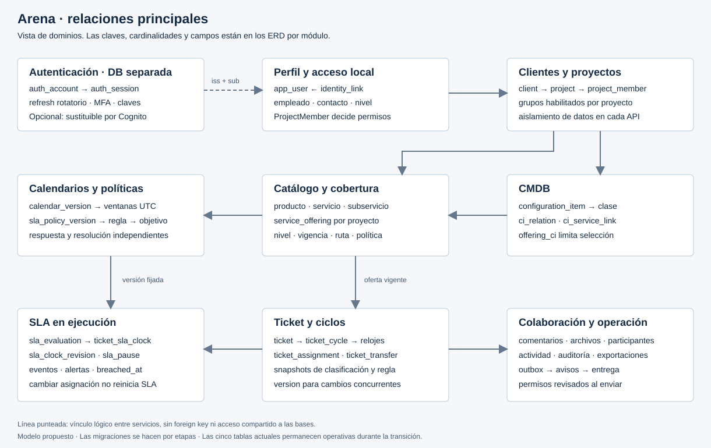
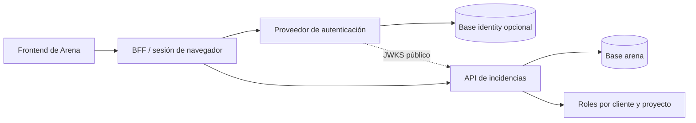

# Diseño de SLA, datos y autenticación de Arena

Estado: propuesta de implementación gradual; no se ha modificado la base actual ni el código de la aplicación.

## 1. Qué existe y qué cambiar

La revisión de `Backend/prisma/schema.prisma` encuentra **cinco modelos**: User, Project, ProjectMember, Ticket y Comment. Ticket tiene tres estados, una prioridad, un asignado y createdAt/updatedAt. No tiene calendario, clasificación de servicio, ciclo, fecha límite, pausa ni evaluación SLA.

- `CreateTicket.ts` genera la clave con `countByProjectId + 1`. Dos solicitudes concurrentes pueden obtener el mismo número. Sustituir por un contador bloqueado dentro de la transacción.
- `PrismaTicketRepository.update` sobrescribe campos sin versionado optimista. Añadir compare-and-set antes de construir transferencias y relojes.
- `AssignTicket.ts` valida la membresía del destinatario; los casos de uso de asignación/transición no reciben el actor para decidir la autorización. Añadir un contexto de actor y una política de permisos por recurso.
- `JsonWebTokenService` firma y verifica con un secreto compartido; no especifica issuer, audience ni lista explícita de algoritmos.
- `AuthController.logout` borra la cookie. Actualmente no hay sesión persistida que pueda revocarse, ni refresh token.

La recomendación es conservar la arquitectura de incidencias como monolito modular y extraer autenticación mediante un contrato bien definido. El esquema objetivo describe el destino; cada PR incorpora solo las tablas y columnas que necesita.

## 2. Reglas de negocio propuestas para el SLA

Estas decisiones son reglas propuestas para Arena. Los compromisos comerciales concretos deben configurarse; no son una norma universal de ITSM.

### Dos relojes independientes

1. **Primera respuesta:** empieza cuando el servidor acepta la solicitud y termina con la primera respuesta pública humana y útil del equipo. Un acuse automático, asignar a alguien, abrir el ticket o escribir una nota interna no lo detienen.
2. **Resolución:** empieza en el mismo instante y termina al registrar una solución válida. Confirmar el cierre por el cliente es otro evento y no prolonga este reloj.

Un ticket puede haber cumplido la respuesta e incumplido la resolución. Por eso no basta con un solo `dueAt`, un booleano `slaExpired` o el `updatedAt` del ticket.

Tipos como tareas de desarrollo pueden usar fecha objetivo sin SLA contractual. Guardar esa ausencia explícitamente (`sla_mode=NONE`); los registros anteriores a la implantación usan `LEGACY_UNMEASURED`, nunca “cumplido” ni objetivo de cero minutos.

La configuración explícita de inicio, pausa y fin coincide con el enfoque documentado por [Atlassian para SLA](https://support.atlassian.com/jira-service-management-cloud/docs/set-up-sla-conditions/). Las reglas de transferencia y versionamiento descritas aquí son decisiones propias del proyecto.

### Al crear una solicitud

La operación de creación debe:

1. Autenticar al actor y obtener cliente/proyecto desde una membresía activa.
2. Verificar cobertura y vigencia de producto, servicio, subservicio y CI, si aplica.
3. Obtener el nivel del solicitante desde la membresía; nunca confiar en el nivel enviado por el navegador.
4. Tomar un instante UTC único `accepted_at` del servidor. El reloj empieza aquí aunque todavía no haya agente o la jornada esté cerrada.
5. Resolver la oferta publicada y **la versión explícita** de reglas SLA y calendario que contiene. No buscar “la última política” por nombre durante cada consulta.
6. Evaluar condiciones tipadas con orden único. Primera coincidencia gana; debe existir fallback contractual. Las condiciones no son SQL ni JavaScript ejecutable.
7. Calcular prioridad y objetivos independientes. El motor de enrutamiento determina el grupo sin alterar esos objetivos.
8. Guardar ticket, número, ciclo inicial, evaluación/snapshot, dos relojes con sus revisiones, asignación inicial, evento y outbox **en una transacción**.
9. Hacer commit y luego publicar los avisos. Un error de SES/SQS no debe eliminar el ticket.

La autorización y el cálculo deben usar datos consistentes. El publicador produce versiones inmutables y cambia la oferta activa de forma atómica; crear usa esa misma fila/version. Revalidar vigencia y version antes de escribir.

Para creaciones con SLA obligatorio, impedir publicar ofertas sin una política fallback válida. Si aun así falta configuración, devolver un error explícito y conservar el formulario; nunca inventar 24×7 ni un deadline cero. Una bandeja de triage sin cobertura puede existir como producto explícito, con su propia política, sin admitir silenciosamente contratos inválidos.

La clave de idempotencia pertenece a actor + operación + proyecto. Un reintento con el mismo cuerpo devuelve el ticket y el mismo `accepted_at`; no crea otro reloj.

### Tiempo hábil, calendario y zona

- Duraciones configuradas en minutos/horas se convierten a **milisegundos enteros**. No almacenar decimales de horas ni redondear cada tramo.
- Instantes persistidos como `DATETIME(3)` en UTC. MySQL no añade semántica de zona a DATETIME; todas las conexiones y el código deben aplicar UTC.
- Calendario identificado por zona IANA; un offset como UTC-6 no representa todas las reglas posibles de una zona.
- Semana local con intervalos `[inicio, fin)`. Ejemplo: 09:00–14:00 y 15:00–18:00.
- Una excepción de fecha reemplaza la jornada completa. Sin intervalos = cerrado. Con intervalos = apertura especial.
- Los festivos recurrentes se expanden a fechas concretas al publicar. No asumir un país ni importar automáticamente días sin revisión.
- Dividir los turnos que cruzan medianoche en intervalos de dos días.
- Declarar cómo resolver horas repetidas o inexistentes por cambio de horario. Propuesta: rechazar una publicación ambigua hasta que el administrador la ajuste.
- Materializar ventanas UTC y guardar versión de tzdb/motor y hash. No recalcular el pasado con una librería de zonas más nueva.
- Cada versión declara cobertura de fechas. Validar que pueda alojar el objetivo más largo. Si se agota, alertar y ampliar de forma reproducible con las reglas originales; nunca cambiar de calendario en silencio.

Ejemplo con calendario ficticio: martes 15/09/2026, 16:30, objetivo 4 horas hábiles, horario 09–14 y 15–18, miércoles 16 configurado como cierre completo. Consume 1 h 30 min el martes y 2 h 30 min el jueves; vence **17/09/2026 a las 11:30** de la zona del calendario.

Si el cliente envía el martes a las 20:00, el ticket existe desde las 20:00, pero el consumo empieza en la siguiente ventana abierta.

### Pausar y reanudar

Propuesta inicial: se puede pausar **resolución** al esperar información del cliente, siempre que:

- La versión contractual permita `WAITING_CUSTOMER`.
- Exista una pregunta pública asociada, actor autorizado y motivo.
- Se guarden inicio, fin, comentario y motivo en `sla_pause`.
- Haya una fecha de revisión; el contrato puede fijar un límite y reanudación automática.

La primera respuesta normalmente no necesita pausa: la pregunta pública que abre la espera ya cuenta como la primera respuesta válida. La pausa se evalúa por reloj, no mediante un único booleano del ticket.

No pausar por falta de personal, error de asignación, trabajo interno, cambio de área o demora de un proveedor, salvo que el contrato permita explícitamente esta última causa. “Bloqueado” no equivale a “SLA pausado”.

Al pausar:

1. Bloquear el reloj y verificar la versión del ticket.
2. Acumular tiempo hábil desde su checkpoint.
3. Comprobar primero si ya incumplió.
4. Registrar la pausa y poner estado PAUSED.
5. Guardar el último deadline y dejar `due_at=NULL`; no hay deadline definitivo mientras se desconoce cuándo volverá a correr.

Al reanudar:

1. Cerrar la pausa una sola vez.
2. Conservar el consumo previo.
3. Calcular `restante = max(0, objetivo - consumido)`.
4. Sumar el restante desde la reanudación usando el calendario congelado.
5. Registrar evento y reprogramar alertas.

**No sumar simplemente la duración de la pausa al vencimiento.** Una espera de 24 horas puede incluir 16 horas que ya eran no laborables. Solo se excluye la intersección entre pausa y tiempo hábil; no descontar dos veces intervalos solapados.

Propuesta V1: una sola pausa abierta por reloj. Otra petición compatible se trata como repetición idempotente o conflicto, no abre una segunda pausa. Si más adelante se permiten varias causas concurrentes, usar la unión de intervalos y reanudar cuando no quede ninguna causa.

Ejemplo: jueves 09:00, objetivo 4 h, horario 09–14 y 15–18. A las 10:00 espera al cliente (1 h consumida); el cliente responde a las 12:00. Restan 3 h: 12–14 más 15–16, vencimiento a las **16:00**.

Una pausa solicitada a las 13:01 no borra un incumplimiento ocurrido a las 13:00.

### Cambio de área, rechazo y custodia

Separar **estado del ticket** de **estado de la asignación/transferencia**.

- El agente puede declinar su asignación con motivo. El ticket sigue abierto y queda en la cola de su grupo; se notifica al gestor. Si estaba en progreso y queda sin agente, vuelve a Pendiente.
- Para moverlo a otro grupo se crea `ticket_transfer`: REQUESTED → ACCEPTED, DECLINED o CANCELLED.
- El grupo de origen conserva custodia hasta que el destino acepte. No dejar un ticket sin cola mientras alguien decide.
- Aceptar termina el intervalo anterior de asignación, crea el nuevo y actualiza la proyección del ticket atómicamente.
- Declinar la transferencia conserva el grupo original y exige motivo; el gestor puede reenviar o escalar.
- Un destino fuera del proyecto no puede recibir el contenido. Habilitar grupo no da membresía automática a todos sus usuarios.
- Una sola transferencia pendiente; aceptación, cancelación y declinación concurrentes usan version/bloqueo.
- Definir `review_due_at` para escalar transferencias sin contestación y evitar que el ticket circule indefinidamente.

**Transferir o declinar no pausa, reinicia ni amplía el SLA del cliente.** Si a un ticket con 4 h de resolución le queda 1 h, la nueva área recibe 1 h. La UI debe mostrar ese tiempo antes de aceptar.

Una solicitud realmente fuera de alcance puede cancelarse/rechazarse por un gestor autorizado con causa y comunicación pública. Es un resultado del ticket distinto de declinar una asignación. Los incumplimientos previos permanecen; los reportes separan cancelados de resueltos.

Puede añadirse un **OLA** (objetivo operativo interno) por área para medir aceptación y trabajo. Ese reloj tiene presupuesto propio por tramo y nunca reemplaza el SLA del cliente. En esta versión solo se modela la revisión de transferencias; OLA completo queda como extensión, no se confunde con los dos relojes contractuales.

### Si cambia la política SLA

Caso normal:

- Editar crea borrador V2. Publicar congela V2 y cambia la oferta para solicitudes nuevas.
- Un ticket creado con V1 conserva regla, objetivo, calendario y pausas de V1.
- Una fecha límite de V1 no cambia porque se publique V2, ni porque alguien cambie nombre/nivel de un contacto.
- Desactivar un catálogo impide nuevas selecciones; no elimina referencias históricas.

Ejemplo: solicitud A nació con resolución de 8 h. Se publica V2 con 4 h. A conserva 8 h; B creada con V2 recibe 4 h.

Excepción explícita: migrar solicitudes abiertas por corrección contractual. La acción requiere permiso, motivo, vista previa por ticket y auditoría. Antes de cambiar, liquidar consumo y comprobar incumplimiento bajo la revisión anterior. Crear otra `sla_evaluation` y `sla_clock_revision`; mantener el ciclo y todo el consumo.

Si ya se consumieron 3 h y el nuevo objetivo es 4 h, queda 1 h. Si ya se consumieron 5 h, la nueva revisión queda vencida al aplicarse, salvo otro tratamiento contractual expresamente acordado. No inventar un vencimiento retroactivo bajo un contrato que todavía no existía. Registrar la fecha efectiva del ajuste.

En V1 se recomienda mantener el calendario original en estas migraciones y cambiar solo el presupuesto. Migrar también calendario necesita partir el consumo por tramos: lo anterior conserva su calendario y lo posterior usa el nuevo. Nunca volver a medir toda la vida con el calendario nuevo.

Reclasificar servicio/impacto requiere permiso y motivo. Evaluar dentro de la versión fijada cuando siga siendo el mismo contrato; cambiar de oferta/contrato implica una revisión explícita. Reasignar responsable, por sí solo, no reclasifica.

### Resolver, reabrir e incumplir

- Resolver detiene resolución y cierra el ciclo. Si la resolución incluye respuesta pública válida, también puede completar primera respuesta en ese instante.
- Cerrar por aceptación no crea otro ciclo.
- Reabrir requiere motivo y crea ciclo N+1; los ciclos anteriores nunca se reescriben. Propuesta: usar la política del contrato original, salvo migración explícita.
- En el nuevo ciclo se miden respuesta a la reapertura y nueva resolución. Se reportan por ciclo y también “ticket con cualquier incumplimiento”, para no mejorar cifras reabriendo.
- `breached_at` se fija una sola vez. Completar tarde cambia el estado del reloj a STOPPED, pero conserva ese campo.
- Completar exactamente en el deadline cumple. Incumple al superar el deadline sin evidencia de cumplimiento a tiempo. La precisión es milisegundos.

## 3. Cómo guardar y calcular los tiempos

Persistir:

- `ticket.accepted_at`: instante real de aceptación.
- `ticket_cycle`: inicios, fines y motivo de cada ciclo.
- `sla_evaluation`: contexto de entrada, versión de reglas, regla ganadora, resultado y versión del motor.
- `ticket_sla_clock`: una fila por ciclo/métrica; estado, consumo acumulado, checkpoint, deadline, fin e incumplimiento.
- `sla_clock_revision`: presupuesto, calendario y evaluación utilizados desde cada cambio.
- `sla_pause`: intervalos y motivos.
- `sla_clock_event`: secuencia, delta de consumo, fechas antes/después y hecho que causó el cambio.
- `sla_alert`: avisos deduplicados por reloj/revisión/umbral.

Guardar `consumed_ms` como proyección eficiente; eventos, revisiones y ventanas permiten verificarlo. No guardar un “remainingTime” que deba actualizarse cada segundo. La API calcula la lectura usando el checkpoint y el instante actual; la UI puede animar a partir de serverNow, pero el backend es la autoridad.

Pseudocódigo de negocio:

```text
consumo(now):
  elapsed = consumed_ms
  si state == RUNNING:
    elapsed += business_ms(calendar_revision, checkpoint_at, now)
  devolver elapsed

pausar(t):
  verificar permisos, estado, versión, política y comentario
  bajo bloqueo: verificar vencimiento anterior, actualizar consumo(t)
  abrir pausa, fijar checkpoint=t, state=PAUSED, due_at=null
  guardar hecho y outbox en la misma transacción

reanudar(t):
  cerrar pausa, mantener consumed_ms, checkpoint=t
  state=RUNNING
  due_at=add_business_ms(calendario, t, max(0,target_ms-consumed_ms))
  no borrar breached_at
```

Los intervalos RUNNING de una versión nunca incluyen pausas porque cada transición deja checkpoint; al reconstruir desde eventos excluir la unión de pausas. No mezclar los dos métodos y descontar dos veces.

Un job periódico detecta vencimientos con índice `(state, due_at)` y trabajo por lotes. No necesita crear un scheduler individual por cada ticket ni actualizar todas las filas cada segundo.

El job no define la verdad del incumplimiento: si debía vencer a las 13:00 y el worker despierta a las 13:02, `breached_at=13:00`, `created_at` del evento refleja su detección posterior. Las lecturas y transiciones también calculan el estado correcto.

Antes de enviar un aviso, el worker recarga estado/revisión y descarta trabajo obsoleto. Un aviso antiguo no debe salir después de una pausa, resolución o cambio de presupuesto. Outbox y dedupe soportan reintentos; no asumir entrega exactamente una vez.

## 4. Modelo de datos entregado



- [Explorador visual y relaciones](../docs/database/diagrama.html).
- [Vista general SVG](../docs/database/overview.svg).
- [Diagramas ERD por módulo](../docs/database/diagramas.md).
- [SQL objetivo de incidencias](../docs/database/arena-target.mysql.sql).
- [SQL opcional de autenticación](../docs/database/identity-target.mysql.sql).
- [DBML incidencias](../docs/database/arena-target.dbml) y [DBML autenticación](../docs/database/identity-target.dbml).
- [Diccionario de campos y referencias](../docs/database/diccionario.md).
- [Fuente del modelo](../docs/database/model.mjs) y [generador](../docs/database/generate.mjs).

La propuesta contiene **68 tablas de incidencias y 10 de autenticación opcional**. Es el destino del alcance completo; relaciones muchos-a-muchos, versiones y auditorías explican buena parte del tamaño.

No se necesita una tabla para cada pantalla: dashboard, Kanban, filtros y reportes son consultas/proyecciones. El motor SLA es código de dominio, no un microservicio ni una tabla con fórmulas SQL arbitrarias.

Se conserva MySQL por coherencia con el proyecto. El DDL objetivo utiliza MySQL 8.4/InnoDB, FK, claves compuestas por cliente y CHECK. Es **DDL de referencia para una base vacía**, no reemplaza `schema.prisma`, no es una migración aplicable sobre la base actual y no se ejecutó contra ella.

Fuente primaria para restricciones: [MySQL FK](https://dev.mysql.com/doc/refman/8.4/en/create-table-foreign-keys.html).

### Invariantes que la aplicación debe mantener

El SQL aporta protección estructural, pero no sustituye las políticas transaccionales:

- Usuario interno activo para asignación; contacto activo para solicitante externo; membresía activa en el proyecto.
- Una oferta y un CI seleccionados pertenecen al mismo proyecto autorizado, además del mismo cliente.
- Un subservicio de `ci_service_link` pertenece al servicio indicado.
- El comentario usado para pausar o adjuntar corresponde al mismo ticket, no solo al mismo cliente.
- Ciclo, evaluación, regla, objetivo, revisión y reloj pertenecen al mismo ticket y jerarquía de versiones.
- Una relación de dependencias es acíclica cuando su tipo lo exige.
- Intervalos de calendario no se solapan; un calendario cubre todo el objetivo a calcular.
- Publicaciones inmutables, sin dos ofertas activas incompatibles para la misma combinación/fecha.
- Reglas con orden único, fallback final obligatorio, advertencias de sombra/solapamiento y condiciones tipadas que referencian IDs autorizados.
- La proyección `ticket.current_group_id` coincide con su asignación abierta.
- El puntero `active_revision_number` coincide con una revisión del reloj creada en la misma transacción.
- La transición del ticket, los relojes, eventos y outbox se confirman o revierten juntos.

Los índices generados sí impiden más de un ciclo abierto, asignación abierta, pausa abierta por reloj o transferencia pendiente por ticket. MySQL no tiene el mismo mecanismo de índices parciales que otros motores; aquí se usan claves generadas con NULL para filas históricas.

Evitar borrados en cascada de usuarios/comentarios y datos contractuales. El DDL usa RESTRICT; la aplicación desactiva/archiva. Definir retención/pseudonimización para datos personales y logs como tarea operativa.

## 5. Cambios pequeños y mapa de migración

**Corrección al plan anterior:** no implementar doce historias grandes de catálogos antes de volver a tocar tickets. Las historias describen el resultado completo; cada una puede tener cortes A/B/C. La oferta completa se exige cuando se habilite la nueva funcionalidad, no durante toda la migración.

### M0 — Base y seguridad actual

US-00, US-01 y primer corte de US-15. Pruebas de permisos por actor, errores, contador de tickets y control optimista. Mantener el flujo actual funcionando.

PR 1: pruebas y endpoints autorizados. PR 2: contador con transacción. PR 3: version y 409. No mezclar calendario ni autenticación nueva todavía.

### M1 — Clientes y acceso

US-02–US-06, ORG-01/02-A. Añadir cliente, contacto, nivel estándar, rol por proyecto y grupos. Mantener IDs de usuarios/tickets.

Migración expand/contract:

1. Añadir columnas nullable/tablas nuevas.
2. Crear un cliente de demostración explícito para los proyectos legacy; no inferir contratos reales.
3. Rellenar por lotes idempotentes y validar conteos/huérfanos.
4. Activar lectura del nuevo alcance por proyecto.
5. Aplicar NOT NULL/constraints solo después del backfill comprobado.

`ProjectMember` existente se amplía; no hace falta borrarlo y recrearlo.

### M2 — Primer SLA útil con catálogo mínimo

CAL-01-A, CAT-01/02/03-A, SLA-01/02-A y US-07-A.

Crear un producto opcional, un servicio/subservicio, una oferta, nivel estándar, grupo por defecto, un calendario y una regla fallback con dos objetivos. El CI es opcional y todavía no hay editor genérico.

Añadir ticket_cycle, evaluación, relojes y revisiones; mostrar dos compromisos en un ticket nuevo. Definiciones pequeñas pueden cargarse con seed validado; siguen siendo versionadas.

Los tickets previos permanecen `LEGACY_UNMEASURED`; no reconstruir pausas que nunca se guardaron ni medirlos como si tuvieran contrato.

### M3 — Trabajo real sin perder el reloj

US-10–US-16-A, XFER-01, SLA-03, SLA-04 y US-19-A. Añadir respuesta pública, notas internas, resolución/reapertura, pausa, transferencia y eventos.

Escribir primero los ejemplos temporales de aceptación. El primer dashboard puede ser una lista simple basada en estos datos.

### M4 — Catálogo y CMDB completos

Cortes B de ORG/CAT/CAL y CMDB-01–03, ROUTE-01, SLA-01/02-B.

Agregar formularios tipados, importaciones, relaciones, niveles avanzados, matriz y simulación. Activar requerimiento de CI solo en ofertas que ya lo tengan configurado. No romper solicitudes legacy al volver obligatorio un campo nuevo.

### M5 — Producto diario y operación AWS

US-17–US-26 y SLA-05; completar adjuntos verificados, avisos, portal, filtros, Kanban, backups y observabilidad. Preparar CI/infraestructura desde M0; publicar piloto tras las puertas de aceptación de seguridad.

### M6 — Reportes y evidencia

US-27–US-29: alertas, métricas por ciclo/ticket, exportación y demostración. Validar “any breach” y población elegible; separar legacy/cancelados.

### Línea AUTH — Extraer autenticación con el sistema ya protegido

AUTH-01 empieza después de M1. AUTH-02/03 pueden desarrollarse como proyecto aparte y conectarse a un entorno de pruebas; no bloquean M2–M4.

En cada corte: migración compatible, feature flag por proyecto, pruebas de API antigua/nueva, backfill reanudable y rollback de aplicación conservando columnas. No ejecutar DDL destructivo durante la primera activación.

Mapa conceptual de tablas actuales:

- User → app_user + identity_link; passwordHash migra a identity solo al cambiar proveedor. No perder UUID ni la autoría histórica.
- Project → project con client_id, estado y version.
- ProjectMember → project_member con rol, nivel, estado y vigencia.
- Ticket → ticket ampliado y relaciones nuevas; conservar ID/key/createdAt original.
- Comment → ticket_comment con visibilidad explícita. Si no existe evidencia histórica de visibilidad, marcar INTERNAL y publicar solo tras revisión.
- Ticket.attachments JSON → attachment con backfill por key; marcar pendiente de verificación hasta comprobar objeto, tamaño y permisos.
- Open → NEW; InProgress → IN_PROGRESS; Closed → CLOSED. No inventar resolved_at: guardar dato desconocido y excluirlo de métricas de resolución legacy.

Los nombres snake_case del DDL son un objetivo lógico. Prisma puede usar `@map`/`@@map`; no hacer una migración de renombrado masivo solo por estética.

## 6. Autenticación como servicio independiente

Sí tiene sentido para tu objetivo de práctica. Recomiendo **dos aplicaciones**, con la API de incidencias internamente modular:



El BFF puede comenzar dentro del backend actual y permanecer ahí después de extraer autenticación. Mantiene los tokens del proveedor del lado servidor; el navegador conserva una cookie de sesión. En la primera iteración también puede usarse access cookie HttpOnly y un refresh opaco, pero documentar ese protocolo privado y no presentarlo como un servidor OAuth/OIDC completo.

**Autenticación posee:** credenciales, email verificado, MFA, recuperación, sesiones, refresh tokens, claves y eventos de seguridad.

**Incidencias posee:** perfil local estable, empleados/contactos, clientes, proyectos, membresías, roles, nivel del solicitante y autorización de tickets. Un JWT válido no concede acceso a todos los proyectos.

Contrato entre ambas: `(issuer, subject) → app_user.id`. No relacionar por correo, que puede cambiar, ni por FK entre bases. Incidencias no consulta la tabla de contraseñas. Invitación queda en incidencias; después del login se consume con email verificado y se vincula al subject exacto.

### Opciones y recomendación

- **Práctica de refresh, revocación y firma:** servicio propio `arena-identity` con la base opcional entregada, biblioteca criptográfica madura y pruebas de contrato. Se puede separar en otro repositorio cuando se implemente. Un proyecto separado es útil aunque primero se ejecute localmente junto al resto.
- **Versión AWS administrada:** adaptador a Cognito usando authorization code + PKCE, descubrimiento/JWKS y verificación específica de tokens. No necesitas construir las tablas auth cuando Cognito posea esos datos.
- Evitar implementar un proveedor OAuth/OIDC completo para empezar. Si deseas demostrar ese protocolo, integrar uno existente primero y no inventar un grant de contraseñas.

AWS documenta [rotación de refresh tokens](https://docs.aws.amazon.com/cognito/latest/developerguide/amazon-cognito-user-pools-using-the-refresh-token.html). Esa opción es alternativa al almacenamiento propio, no una segunda copia obligatoria de credenciales.

### JWT y refresh para la práctica

- Access token breve: propuesta inicial de 5–10 minutos, ajustable al riesgo y flujo.
- Firma asimétrica y `kid`; API solo recibe claves públicas. No compartir una clave HMAC que permita a cada API emitir tokens.
- Verificar firma, lista cerrada de algoritmos, `iss`, `sub`, `aud`, `exp`, `nbf` cuando exista y tipo de token. Parsear payload con esquema; decodificar no valida.
- Access token contiene identidad, audience, scopes gruesos, sid y jti. Los permisos de proyecto se consultan en incidencias.
- ID token no se usa como credencial de acceso a la API. Para Cognito seguir sus validaciones de `token_use`, issuer, client y scopes, no aplicar ciegamente un validador de JWT propio.
- Refresh token opaco, aleatorio de alta entropía. Guardar solo su hash y la sesión/familia, generación, expiración, uso y revocación.
- Rotar refresh en cada uso: bloquear sesión/token, consumir el anterior y crear el siguiente en una transacción. Una única generación sucesora.
- Reutilización de token consumido fuera de un reintento controlado revoca la familia. Frontend/BFF serializa refresh para evitar que dos pestañas provoquen falsos positivos. Para V1, si se pierde la respuesta de rotación, pedir login; una ventana de gracia segura es una mejora explícita.
- Duración absoluta e inactividad separadas; rotar no prolonga indefinidamente la sesión.
- Logout/cambio de contraseña/recuperación revocan sesiones según alcance. No basta con borrar cookie.
- Claves privadas en KMS/secret store; no en DB ni repositorio. Publicar antiguas claves públicas durante la vida máxima de tokens emitidos más skew; rotación de claves no es revocación de una sesión.
- Cookie Secure, HttpOnly, SameSite explícito, alcance mínimo y protección CSRF/Origin. No guardar refresh en localStorage.

Estas reglas siguen [RFC 8725 para JWT](https://www.rfc-editor.org/rfc/rfc8725.html), [RFC 9700 para seguridad OAuth y rotación](https://www.rfc-editor.org/info/rfc9700/) y [OWASP para sesiones](https://cheatsheetseries.owasp.org/cheatsheets/Session_Management_Cheat_Sheet.html).

### Revocación y fallos de red

Verificar firma localmente no detecta por sí solo que una sesión fue revocada. Definir una garantía explícita:

- Primer corte de servicio propio: consultar estado de sesión `sid` al proveedor en cada petición protegida; timeout breve y fail closed. Si identity falla, devolver 503 para esa operación, no aceptar tokens sin comprobar.
- Optimización posterior: caché de estado con TTL máximo documentado, eventos de revocación y reconciliación. Una garantía de “revocación inmediata” no puede depender únicamente de eventos que llegan eventualmente.
- Si se acepta revocación demorada hasta expirar el access token, documentar esa ventana y ajustar pruebas. No llamarla inmediata.
- La revocación de membresías en incidencias debe aplicarse en el propio servicio aunque el JWT siga válido.

AWS también advierte que una biblioteca que solo revisa firma/expiración puede aceptar un JWT revocado: [revocación de Cognito](https://docs.aws.amazon.com/cognito/latest/developerguide/token-revocation.html).

La base opcional es para un servicio propio de primera parte. El BFF/OIDC completo necesitará además su almacenamiento de sesión de navegador y secretos de tokens cifrados, diseñados al elegir el proveedor; no se almacenan como texto plano en incidencias ni se confunden con `auth_session`.

## 7. Casos mínimos de aceptación

1. Creación dentro/fuera de horario, festivo, almuerzo, medianoche y cambio de zona.
2. Primera respuesta cumple y resolución incumple, independientemente.
3. Pausa por cliente con comentario; intento de pausa interna rechazado.
4. Pausa fuera de jornada no descuenta dos veces.
5. Respuesta y pausa simultáneas: un orden válido por bloqueo/version, sin doble consumo.
6. Transferencia aceptada/declinada/cancelada; conserva custodia y tiempo restante.
7. Nueva política afecta nuevos tickets y conserva los anteriores.
8. Migración explícita de presupuesto conserva consumo y breach.
9. Resolver exactamente en deadline cumple; resolver después conserva incumplimiento.
10. Worker retrasado o repetido no cambia fecha real ni duplica aviso.
11. Reapertura crea ciclo y no limpia métricas del primero.
12. Otro cliente/proyecto no puede seleccionar oferta, CI, comentario ni reloj ajenos.
13. Reintento de crear devuelve el ticket original, contador sin colisiones.
14. Calendario no cubre el horizonte: error de configuración explicable, sin deadline ficticio.
15. JWT con algoritmo/issuer/audience incorrecto se rechaza.
16. Refresh concurrente produce un solo sucesor; reutilización revoca familia.
17. Logout invalida la sesión según la garantía elegida y se comprueba contra una API protegida.
18. Backfill legacy no inventa tiempos y el rollback de aplicación conserva datos.
