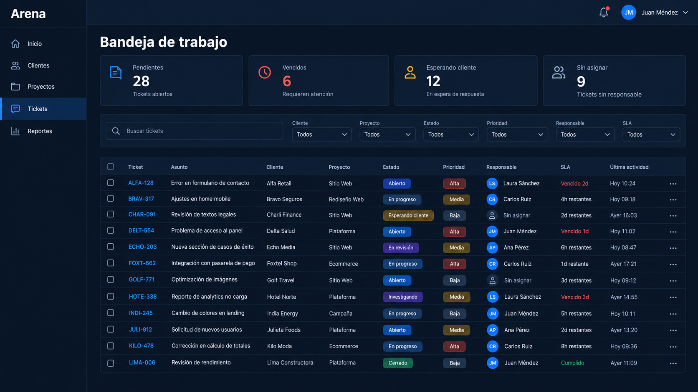
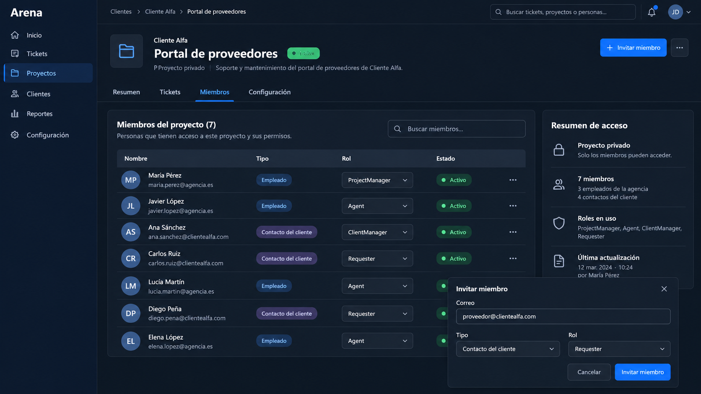
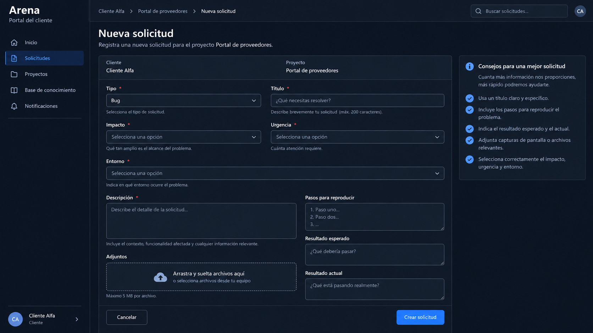
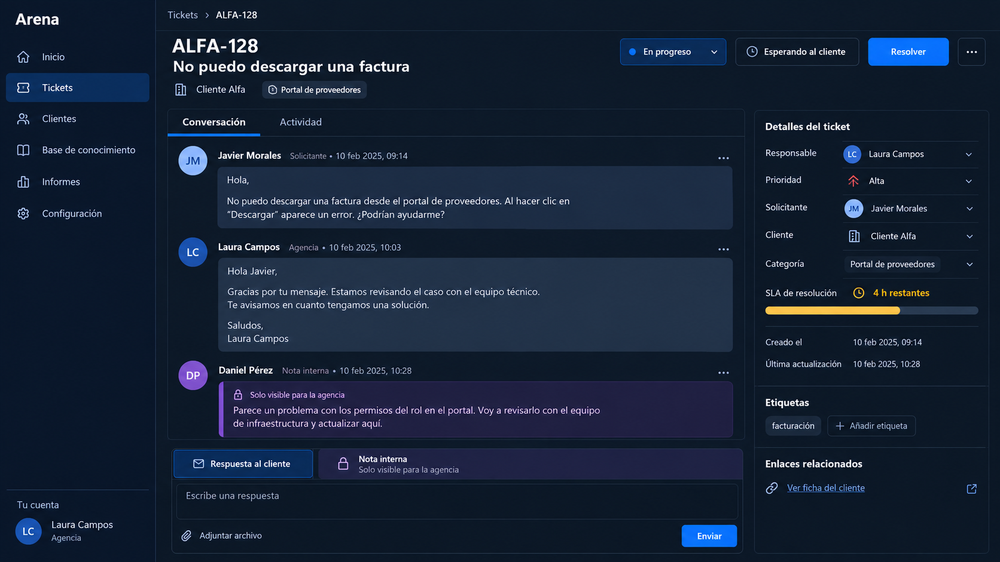
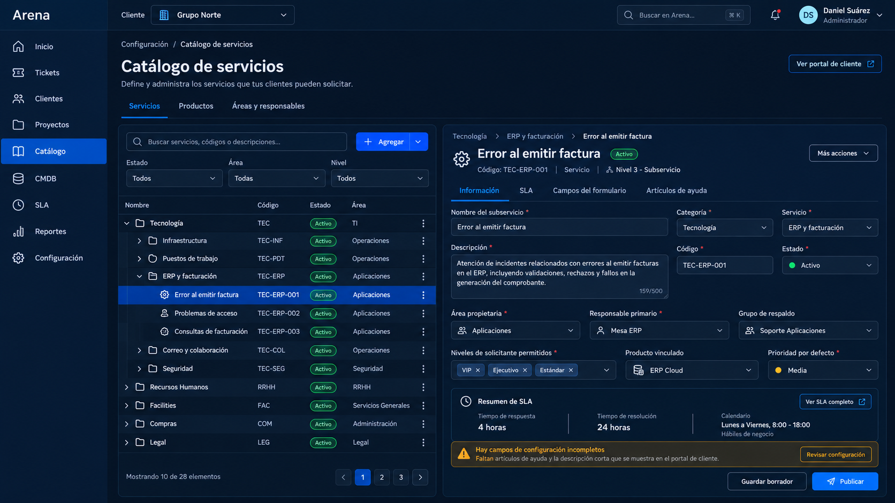
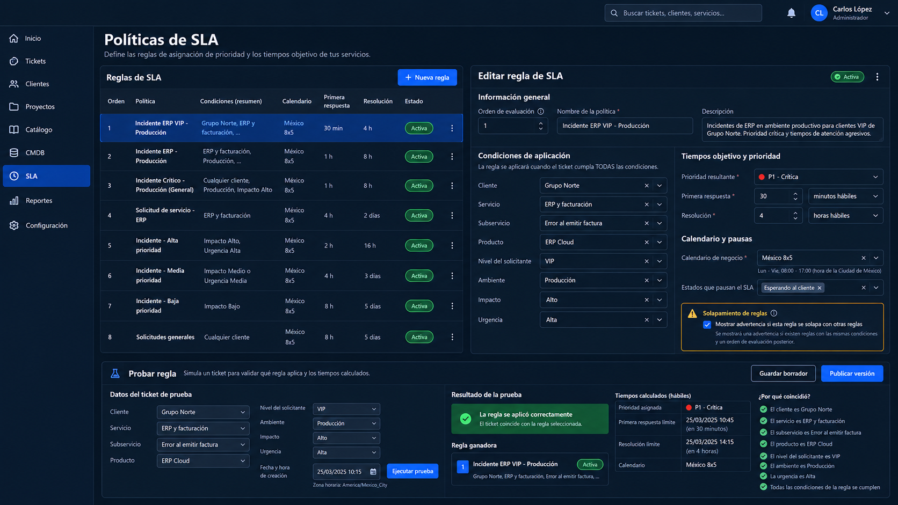
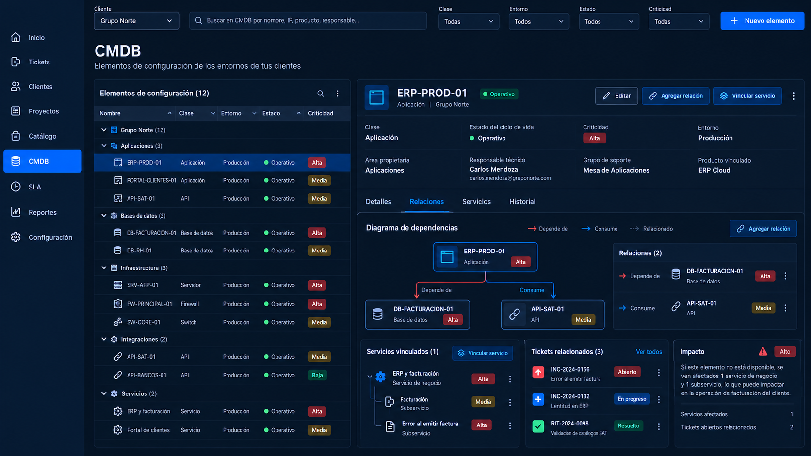
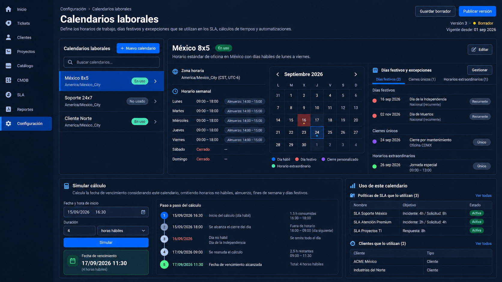
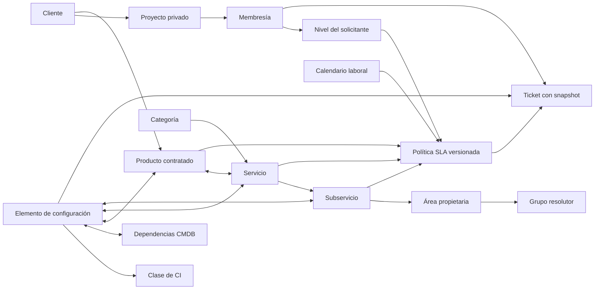

# Historias de usuario ordenadas — Arena

Escenario: una agencia gestiona tickets para varios clientes y proyectos privados.

Estado del documento: backlog propuesto. Las historias todavía no representan funcionalidad implementada. El orden busca entregar recorridos completos y reducir primero los riesgos de aislamiento, permisos e integridad.

## Cómo usar este backlog

El orden efectivo de implementación es **M0–M6** descrito en [diseño de SLA, datos y autenticación](./diseno-sla-datos-autenticacion.md). Las entregas de este documento agrupan el alcance completo; no exigen terminar todo el editor de catálogos o la CMDB antes de mejorar un ticket.

Cada historia grande admite cortes A/B: A entrega un recorrido pequeño completo con configuración mínima validada; B añade el editor, opciones y casos avanzados. Una historia incluye dominio, base de datos, API, interfaz, permisos y pruebas cuando corresponda. No cerrar un corte con permisos pendientes.

**Modelo objetivo:** [diagrama navegable](../docs/database/diagrama.html), [SQL y diccionario](../docs/database/README.md). No aplicar el esquema completo como primera migración.

Los tamaños son relativos:

- S: cambio pequeño, normalmente una PR.
- M: varias piezas coordinadas; puede requerir dos PRs compatibles.
- L: dividir internamente en migración compatible, backend y UI, pero cerrar la historia únicamente cuando funciona de extremo a extremo.

Antes de comenzar cada historia:

1. Confirma sus dependencias.
2. Escribe o actualiza el contrato HTTP.
3. Implementa la regla en dominio/aplicación.
4. Persiste con restricciones y migración compatible.
5. Expón únicamente los datos autorizados.
6. Construye estados de carga, vacío, error y éxito.
7. Prueba éxito, error, acceso denegado y concurrencia cuando aplique.

## Referencias visuales

Las imágenes fueron generadas como conceptos de alta fidelidad con ImageGen a partir del estilo actual de Arena. Son guía de jerarquía, contenido y flujo; el texto de este documento define el comportamiento exacto.

### V1 — Bandeja interna de la agencia

Debe contener navegación por clientes, proyectos, tickets y reportes; indicadores accionables; búsqueda; filtros por cliente, proyecto, estado, prioridad, responsable y SLA; listado paginado; última actividad; estados de carga, vacío y error.

### V2 — Proyecto y miembros

Debe contener contexto cliente/proyecto, estado del proyecto, pestañas, miembros internos y externos diferenciados, rol por proyecto, estado de invitación/membresía, invitación y resumen de acceso. Cambiar un selector no debe persistir sin autorización, confirmación y manejo de error.

### V3 — Portal del cliente y nueva solicitud

Debe contener cliente y proyecto derivados de la ruta/sesión, tipo, título, descripción, impacto, urgencia, campos condicionales por tipo, adjuntos y ayuda contextual. El cliente informa impacto y urgencia; el gestor confirma la prioridad.

### V4 — Detalle de ticket para la agencia

Debe contener identidad del ticket, cliente/proyecto, estado, acciones permitidas, conversación, actividad, respuesta pública, nota interna, adjuntos con visibilidad, responsable, solicitante, prioridad, SLA, etiquetas y relaciones autorizadas.

### V5 — Catálogo de servicios

Debe contener categoría, servicio y subservicio; producto relacionado; área propietaria; grupo resolutor; responsable principal y respaldo; niveles de solicitante permitidos; estado borrador/publicado y resumen de la política SLA aplicable.

### V6 — Políticas y matriz SLA

Debe permitir ordenar reglas, detectar solapamientos y combinar cliente, servicio, subservicio, producto, nivel del solicitante, ambiente, impacto y urgencia. Antes de publicar debe explicar qué regla gana, qué calendario usa, la prioridad resultante y los vencimientos calculados.

### V7 — CMDB y relaciones

Debe contener clase, ciclo de vida, ambiente, criticidad, propietario, responsable técnico, producto, servicios/subservicios vinculados, dependencias entre elementos de configuración, tickets activos e impacto de una posible falla.

### V8 — Calendarios laborales

Debe configurar zona horaria, jornadas por día, intervalos no laborables, festivos recurrentes, cierres excepcionales y horarios extraordinarios. El simulador debe explicar paso a paso cómo obtiene una fecha límite.

## Modelo conceptual del dominio

Producto, servicio y elemento de configuración representan conceptos diferentes. El producto expresa lo contratado o soportado; el servicio/subservicio expresa el tipo de atención; el CI representa la instancia concreta afectada. El ticket conserva una copia de la clasificación y de la versión SLA aplicada para que los cambios futuros de catálogo no reescriban su historia.

## Requisitos transversales de la primera versión

- La API deniega por defecto y valida cuenta, relación con la agencia/cliente, membresía de proyecto, rol, recurso, visibilidad y estado.
- Un proyecto pertenece a un cliente y no se mueve entre clientes en la primera versión.
- ProjectManager y Agent son roles internos; ClientManager y Requester son externos.
- Los externos nunca reciben tickets, notas, adjuntos, eventos, contadores o resultados internos.
- Las consultas aplican el alcance antes de paginar, contar, agregar, exportar o cachear.
- El frontend nunca concede permisos; consume allowedActions para presentar las acciones decididas por el backend.
- Todos los cuerpos, parámetros y queries se validan; se rechazan campos desconocidos en comandos sensibles.
- Cada mutación importante registra actor, instante, requestId y cambio; los secretos, cookies y URLs firmadas se redactan.
- Las mutaciones concurrentes usan version o una operación atómica; los reintentos no crean duplicados.
- Fechas persistidas en UTC; presentación según la zona del proyecto.
- Los catálogos, calendarios y políticas se publican por versión y fecha de vigencia; no se modifican retroactivamente.
- Los registros referenciados se desactivan en lugar de borrarse y conservan una clave estable para auditoría.
- Toda consulta de catálogo, SLA o CMDB aplica el alcance del cliente/proyecto antes de buscar, contar o relacionar.
- Cada historia cumple accesibilidad básica: teclado, foco, labels, mensajes asociados al campo y contraste.
- Respuestas de error: 401 sesión, 403 prohibido en recurso visible, 404 inexistente/no visible, 409 conflicto, 413 tamaño, 422 validación y 429 límite.
- La suite combina pruebas de dominio, HTTP, integración con MySQL y recorridos Playwright. Un mock de S3 no sustituye una prueba contractual del adaptador.

# Entrega 0 — Base segura y reproducible

## US-00 — Ejecutar y validar el proyecto de forma reproducible

**Historia:** Como desarrollador, quiero levantar y verificar todo el sistema con comandos documentados para poder cambiarlo sin depender de configuración implícita.

**Tamaño:** M. **Depende de:** ninguna.

**Requisitos:**

- Elegir y fijar versión de runtime y un solo gestor de paquetes por aplicación.
- Scripts para lint, typecheck, test, build, migración y seed.
- Docker Compose local con MySQL saludable y datos ficticios.
- CI de PR con instalación por lockfile, MySQL aislado y comprobaciones anteriores.
- README con variables, arranque, migraciones y cuentas seed.

**Criterios de aceptación:**

- Un checkout limpio arranca siguiendo el README.
- CI falla ante un error de tipos, prueba o build.
- El seed crea dos clientes ficticios con proyectos y usuarios separados.
- No se versionan secretos ni datos personales reales.

**Interfaz:** ninguna; es habilitador técnico.

## US-01 — Corregir seguridad y errores actuales

**Historia:** Como responsable del producto, quiero cerrar los huecos conocidos antes de incorporar clientes para no construir nuevas funciones sobre accesos inseguros.

**Tamaño:** M. **Depende de:** US-00.

**Requisitos:**

- El registro público deja de aceptar roles privilegiados; preferentemente el alta pasa a invitaciones.
- Todos los casos actuales reciben un ActorContext confiable y verifican membresía.
- Corregir el flujo de error de addAttachment y centralizar respuestas.
- Validar body, params, query y variables S3/AWS/CORS.
- Limitar tamaño JSON y login.

**Criterios de aceptación:**

- Enviar role=Admin o modificar IDs no concede acceso.
- Un usuario de otro proyecto no lista, lee, modifica, comenta ni firma descargas.
- Un fallo inyectado de DB/S3 devuelve respuesta controlada con requestId.
- Las pruebas cubren cada endpoint actual con acceso permitido y denegado.

# Entrega 1 — Clientes, proyectos e identidad

## US-02 — Administrar clientes

**Historia:** Como AgencyAdmin, quiero crear, consultar, pausar y archivar clientes para organizar los proyectos de cada empresa.

**Tamaño:** M. **Depende de:** US-01.

**Requisitos:**

- Modelo Client con nombre, slug, estado y datos de servicio mínimos.
- Slug único y generado/normalizado por servidor.
- Lista paginada y detalle con proyectos y contactos autorizados.
- Paused bloquea altas operativas configuradas; Archived congela sus proyectos.

**Criterios de aceptación:**

- Solo AgencyAdmin administra clientes.
- Archivar requiere confirmación y motivo.
- Los clientes archivados permanecen en historial y no aceptan nuevas mutaciones.
- Un contacto externo nunca puede enumerar otros clientes.

**Interfaz:** navegación “Clientes”, lista con búsqueda/estado y formulario de cliente.

## US-03 — Administrar proyectos privados

**Historia:** Como AgencyAdmin o ProjectManager autorizado, quiero crear y configurar proyectos dentro de un cliente para separar equipos, tickets y permisos.

**Tamaño:** M. **Depende de:** US-02.

**Requisitos:**

- Project.clientId obligatorio, clave estable de 2–10 letras y estado.
- Nombre, descripción, zona horaria y ProjectManager inicial.
- Cliente no editable en V1.
- Archivo/restauración con motivo.

**Criterios de aceptación:**

- La clave es única y no cambia después de crear el proyecto.
- El proyecto aparece solo a miembros explícitos.
- Un proyecto archivado se puede consultar, pero rechaza mutaciones.
- No se puede archivar al cliente y dejar proyectos mutables.

**Interfaz:** detalle mostrado en V2, pestañas Resumen, Tickets, Miembros y Configuración.

## US-04 — Invitar miembros con rol correcto

**Historia:** Como ProjectManager, quiero invitar empleados y contactos del cliente con un rol de proyecto para dar el acceso mínimo necesario.

**Tamaño:** L. **Depende de:** US-03.

**Requisitos:**

- Separar AgencyMember y ClientMember.
- ProjectMember con ProjectManager, Agent, ClientManager o Requester.
- Invitación con token aleatorio hasheado, un uso, vencimiento y alcance.
- Un contacto externo debe pertenecer al cliente del proyecto.
- La invitación no expone si un correo tiene cuenta fuera del alcance.

**Criterios de aceptación:**

- Un contacto no puede recibir rol interno.
- Una invitación vencida, usada o revocada falla.
- Aceptar crea exactamente una membresía aunque se reintente.
- El correo de invitación contiene información mínima y enlace autenticable.

**Interfaz:** V2; modal con correo, tipo de persona, rol y resumen del acceso que se concederá.

## US-05 — Cambiar o retirar acceso sin perder historia

**Historia:** Como ProjectManager, quiero cambiar roles y retirar miembros para mantener los permisos actuales sin borrar sus contribuciones.

**Tamaño:** M. **Depende de:** US-04.

**Requisitos:**

- Revocación efectiva en la siguiente petición.
- No retirar al último ProjectManager activo.
- Reasignar o desasignar tickets abiertos del agente retirado.
- Conservar comentarios y actividad con identidad histórica.
- Cambios de rol y revocaciones auditados.

**Criterios de aceptación:**

- La API rechaza remover al último gestor.
- La UI muestra los tickets afectados antes de confirmar.
- Retirar un contacto de un cliente revoca sus proyectos de ese cliente, sin afectar relaciones válidas con otros clientes.
- Ningún listado conserva acceso por caché después de la revocación.

**Interfaz:** V2; menú por miembro, confirmación y resumen de impacto.

## US-06 — Iniciar, cerrar y recuperar una sesión

**Historia:** Como usuario invitado, quiero acceder de forma segura y recuperar mi cuenta para usar el portal sin depender del administrador.

**Tamaño:** L. **Depende de:** US-04.

**Requisitos:**

- Session revocable con sid en JWT o identidad administrada equivalente.
- Verificar cuenta y sesión activas en cada petición.
- Recuperación con token hasheado, un uso y vencimiento.
- Logout y cambio de contraseña revocan sesiones.
- Cookie segura, protección CSRF, rate limit y MFA administrativo.
- Limpiar estado y caché del frontend al salir/cambiar de usuario.

**Criterios de aceptación:**

- Una sesión revocada no funciona aunque el JWT no haya expirado.
- La recuperación no revela si el correo existe.
- Recargar una ruta protegida espera la comprobación de sesión.
- Tras cambiar de cuenta no aparece información de la anterior.

**Interfaz:** acceso, recuperación, creación de contraseña y gestión básica de sesiones.

# Entrega 2 — Datos maestros, catálogo, CMDB y reglas SLA

Estas historias preparan las opciones válidas y reglas del ticket. En M2 se implementa un corte mínimo: nivel estándar, grupo por defecto, un servicio/oferta, calendario y fallback SLA. La CMDB y las reglas avanzadas se completan en M4.

## ORG-01 — Configurar áreas, grupos y responsables

**Historia:** Como administrador de la agencia, quiero definir áreas y grupos resolutores para asignar propiedad operativa sin depender de usuarios individuales.

**Tamaño:** M. **Depende de:** US-03 a US-05.

**Requisitos:**

- Área con organización propietaria, código estable, nombre público, estado y responsable funcional.
- Grupo resolutor con miembros internos, responsable principal, respaldo y vigencia.
- Un área puede tener varios grupos; un grupo pertenece a una sola área en V1.
- Los responsables deben ser miembros internos activos y el servidor valida el alcance.
- Desactivar un grupo exige reemplazo si tiene catálogo, reglas o tickets activos.

**Criterios de aceptación:**

- Un administrador de cliente no modifica grupos internos de la agencia.
- Retirar un miembro no deja una regla apuntando a un responsable inválido.
- Un externo solo ve el nombre público necesario para entender quién atiende.
- Todo cambio queda auditado con valor anterior, nuevo y actor.

**Interfaz:** pestaña “Áreas y responsables” de V5, con miembros, responsable principal, respaldo, uso e impacto antes de desactivar.

## ORG-02 — Configurar el nivel del solicitante

**Historia:** Como ClientManager, quiero clasificar a los solicitantes según el contrato para aplicar atención diferenciada de forma controlada.

**Tamaño:** M. **Depende de:** US-04 y US-05.

**Requisitos:**

- Niveles configurables por cliente, por ejemplo VIP, Ejecutivo y Estándar, con código estable y estado.
- El nivel vive en la membresía del cliente/proyecto; no es una propiedad global del usuario ni concede permisos.
- Puede existir un nivel predeterminado del cliente y una excepción por proyecto con vigencia.
- Solo ClientManager autorizado o ProjectManager puede cambiarlo; el solicitante nunca se autoasigna.
- El ticket guarda el nivel efectivo como snapshot al crearse.

**Criterios de aceptación:**

- La misma persona puede tener niveles diferentes en dos clientes o proyectos.
- Cambiar el nivel hoy no modifica tickets anteriores.
- Un nivel inactivo no puede asignarse y no desaparece del historial.
- Las políticas muestran cuántos usuarios utilizan cada nivel antes de desactivarlo.

**Interfaz:** editor de membresía de V2 y administración de niveles con vigencia y vista previa de políticas afectadas.

## CAL-01 — Administrar días hábiles, festivos y excepciones

**Historia:** Como administrador del servicio, quiero calendarios laborales versionados para calcular compromisos con el horario contractual correcto.

**Tamaño:** L. **Depende de:** US-02.

**Requisitos:**

- Zona horaria IANA, uno o varios intervalos laborales por día y opción 24×7.
- Festivos recurrentes, fechas no laborables únicas y aperturas extraordinarias.
- Validar intervalos, solapamientos, cambios de fecha y efectos de zona horaria.
- Versiones borrador/publicada con vigencia; una versión usada es inmutable.
- Motor puro para sumar minutos hábiles y explicar cada tramo omitido.

**Criterios de aceptación:**

- Las pruebas cubren fin de jornada, fin de semana, festivo, pausa diaria y excepción laboral.
- El simulador y el backend producen exactamente el mismo resultado.
- No se elimina una versión referenciada por políticas o tickets.
- Publicar muestra clientes y políticas que usarán la versión.

**Interfaz:** V8, con semana laboral, calendario, lista de excepciones, usos y simulador explicado.

## CAT-01 — Administrar productos soportados

**Historia:** Como responsable comercial, quiero registrar productos para representar lo contratado y relacionarlo con servicios y activos.

**Tamaño:** M. **Depende de:** US-02 y US-03.

**Requisitos:**

- Producto con código, nombre, fabricante/proveedor opcional, descripción, ciclo de vida y estado.
- Catálogo base de la agencia y habilitación explícita por cliente/proyecto con vigencia contractual.
- Producto no equivale a un CI: “ERP Cloud” es producto; “ERP-PROD-01” es su instancia.
- No se borra un producto usado; se retira para nuevas solicitudes.

**Criterios de aceptación:**

- El portal solo recibe productos habilitados para su proyecto y fecha.
- Un cliente no descubre productos contratados por otro.
- Desactivar informa servicios, CIs y políticas afectados.
- Código duplicado dentro del mismo alcance produce 409.

**Interfaz:** pestaña “Productos” de V5, contratos vigentes, servicios relacionados y estado de ciclo de vida.

## CAT-02 — Publicar categorías, servicios y subservicios

**Historia:** Como Service Manager, quiero un catálogo jerárquico para que cada solicitud se clasifique con opciones comprensibles y gobernadas.

**Tamaño:** L. **Depende de:** ORG-01 y CAT-01.

**Requisitos:**

- Jerarquía fija en V1: categoría, servicio y subservicio, cada uno con código estable, orden y estado.
- El subservicio define tipo de solicitud, descripción de ayuda, campos obligatorios y área propietaria.
- Relaciones muchos-a-muchos entre producto y servicio/subservicio cuando correspondan.
- Flujo borrador, publicado y retirado; solo lo publicado aparece al solicitante.
- Versionar cambios que alteren formulario, enrutamiento o cálculo contractual.

**Criterios de aceptación:**

- No se publica un subservicio sin área, grupo resolutor y formulario válido.
- Retirar un nodo impide nuevas selecciones y conserva tickets históricos.
- Cambiar un identificador en el navegador no permite usar catálogo de otro cliente.
- La vista previa reproduce los campos que verá cada nivel de solicitante.

**Interfaz:** V5, árbol buscable, detalle editable, validaciones y acciones Guardar borrador/Publicar.

## CAT-03 — Definir cobertura del catálogo por cliente y proyecto

**Historia:** Como ClientManager, quiero decidir qué servicios puede solicitar cada proyecto para reflejar el contrato y evitar solicitudes fuera de cobertura.

**Tamaño:** M. **Depende de:** ORG-02 y CAT-02.

**Requisitos:**

- Entitlement con cliente, proyecto opcional, producto, servicio/subservicio, niveles permitidos y vigencia.
- La regla más específica del proyecto puede restringir la cobertura del cliente, sin ampliar fuera del contrato.
- Consultas de opciones y creación del ticket usan la misma política de autorización.
- Las solicitudes fuera de cobertura pueden bloquearse o enviarse a revisión contractual según configuración explícita.

**Criterios de aceptación:**

- El portal no muestra ni acepta por API una combinación sin cobertura.
- Vencimiento de contrato no cambia tickets existentes.
- Solapamientos incompatibles impiden publicar y explican la causa.
- La simulación indica si un usuario y fecha pueden solicitar una combinación.

**Interfaz:** matriz de cobertura por proyecto, producto, servicio, subservicio y nivel, con simulador de acceso.

## CMDB-01 — Definir clases y atributos de configuración

**Historia:** Como Configuration Manager, quiero definir clases de CI para capturar datos consistentes de aplicaciones, servidores, bases de datos y otros activos.

**Tamaño:** L. **Depende de:** US-02.

**Requisitos:**

- Clase con código, nombre, atributos tipados, requeridos, validaciones y sensibilidad.
- Clases iniciales: aplicación, servicio técnico, servidor, base de datos y componente externo.
- Esquema versionado; migrar atributos requiere compatibilidad y reporte de registros inválidos.
- Campos sensibles se omiten o enmascaran según rol y nunca contienen secretos en texto claro.

**Criterios de aceptación:**

- No se guarda un CI que incumple el esquema publicado de su clase.
- Un atributo nuevo requerido no rompe CIs existentes sin plan de migración.
- Búsqueda/exportación respetan visibilidad de cada atributo.
- Las versiones anteriores permanecen interpretables en auditoría.

**Interfaz:** administración de clases y constructor de atributos con vista previa y reporte de impacto.

## CMDB-02 — Registrar elementos de configuración

**Historia:** Como Configuration Manager, quiero registrar instancias concretas para conocer qué componente está afectado por una solicitud.

**Tamaño:** L. **Depende de:** CAT-01 y CMDB-01.

**Requisitos:**

- CI con cliente, clave única, clase, nombre, ambiente, criticidad, ciclo de vida, área, responsable y atributos de clase.
- Relación opcional con producto y proyecto; los CIs de un cliente nunca se comparten implícitamente.
- Importación idempotente mediante externalId y reporte por fila; sin sobrescribir silenciosamente.
- Estados planeado, operativo, mantenimiento y retirado; retirar conserva historia.

**Criterios de aceptación:**

- Dos importaciones con el mismo externalId actualizan de forma controlada y no duplican.
- Un solicitante solo ve CIs autorizados para su proyecto y catálogo.
- La criticidad o el ambiente pueden participar en SLA sin conceder acceso adicional.
- El detalle muestra tickets abiertos y cambios auditados.

**Interfaz:** V7, tabla/árbol, filtros, panel de detalle, importación y estados de ciclo de vida.

## CMDB-03 — Relacionar CIs con productos, servicios y dependencias

**Historia:** Como Configuration Manager, quiero modelar relaciones para evaluar el impacto y ofrecer al usuario únicamente los activos pertinentes.

**Tamaño:** L. **Depende de:** CAT-02, CAT-03 y CMDB-02.

**Requisitos:**

- Relaciones tipadas: depende de, usa, aloja, conecta con y reemplaza; sin autorrelaciones.
- Validar dirección, alcance común y ciclos cuando el tipo de relación los prohíba.
- Vínculos explícitos CI-producto, CI-servicio y CI-subservicio con vigencia.
- El portal obtiene CIs por intersección de proyecto, cobertura y vínculos publicados.
- El impacto muestra dependencias relacionadas sin revelar nombres o atributos no autorizados.

**Criterios de aceptación:**

- Un CI de otro cliente no puede relacionarse cambiando identificadores.
- Una relación duplicada devuelve conflicto y no crea dos aristas.
- Al elegir un servicio, el portal solo muestra los CIs aplicables.
- Retirar un vínculo no altera el snapshot de tickets previos.

**Interfaz:** pestañas Relaciones y Servicios de V7, grafo/lista accesible, búsqueda y resumen de impacto.

## ROUTE-01 — Configurar y simular reglas de enrutamiento

**Historia:** Como Service Manager, quiero asignar automáticamente área, grupo y responsable para evitar triage manual en casos conocidos.

**Tamaño:** L. **Depende de:** ORG-01, CAT-03 y CMDB-03.

**Requisitos:**

- Condiciones por cliente, proyecto, producto, servicio, subservicio, clase/CI, ambiente y nivel del solicitante.
- Resultado con área, grupo, responsable principal y respaldo; el usuario individual es opcional.
- Orden explícito, regla de respaldo y detección de reglas activas ambiguas.
- Simulación explica condiciones evaluadas y regla ganadora.

**Criterios de aceptación:**

- Todo subservicio publicado obtiene un grupo por regla o valor predeterminado.
- Dos reglas con igual precedencia y resultado distinto bloquean publicación.
- Si el responsable está inactivo se usa el respaldo o la cola, nunca se pierde el ticket.
- La asignación automática registra la versión de regla aplicada.

**Interfaz:** editor de reglas similar a V6, con orden, cobertura, resultado y prueba de un caso.

## SLA-01 — Configurar la matriz contractual de SLA

**Historia:** Como Service Manager, quiero definir políticas SLA por combinación de condiciones para calcular prioridad y compromisos coherentes.

**Tamaño:** L. **Depende de:** CAL-01, ORG-02, CAT-03 y CMDB-03.

**Cortes:** A en M2 usa CAL/CAT/ORG mínimos y una regla fallback sin CI. B en M4 incorpora la matriz completa y CMDB-03.

**Requisitos:**

- Condiciones por cliente/proyecto, producto, servicio, subservicio, nivel, ambiente, criticidad de CI, impacto y urgencia.
- Resultado con prioridad, tiempo de primera respuesta, resolución, calendario y estados que pausan cada reloj.
- Valores en minutos hábiles; objetivos de respuesta y resolución independientes.
- Precedencia explícita, política de respaldo obligatoria y detección de solapamientos ambiguos.
- Un nivel VIP puede modificar objetivos, pero nunca permisos ni visibilidad.

**Criterios de aceptación:**

- Para una entrada válida existe exactamente una regla ganadora y la explicación es determinista.
- No se publica una política sin calendario vigente ni objetivos positivos.
- Cambiar orden muestra qué casos cambian de resultado.
- Un usuario de otro cliente no puede probar ni enumerar la matriz.

**Interfaz:** V6, tabla ordenada de políticas, editor de condiciones, alertas de conflicto y resultado esperado.

## SLA-02 — Publicar, simular y aplicar versiones SLA

**Historia:** Como responsable del servicio, quiero probar y publicar una versión completa para que cada ticket conserve un cálculo contractual auditable.

**Tamaño:** L. **Depende de:** ROUTE-01 y SLA-01.

**Cortes:** A en M2 usa SLA-01-A y un grupo predeterminado; no necesita ROUTE-01 completo. B añade simulador y matriz. Persistir desde A los ciclos, evaluaciones y revisiones del modelo objetivo.

**Requisitos:**

- La publicación congela políticas, precedencia y referencias a una versión de calendario.
- El simulador recibe un caso y devuelve regla, prioridad, ruta, vencimientos y explicación por pasos.
- Al crear el ticket se guarda policyVersionId, datos relevantes de entrada, objetivos y deadlines.
- Una reclasificación autorizada crea una nueva evaluación con motivo; no borra incumplimientos ni cálculos anteriores.
- El motor es una función de dominio reutilizada por API, worker y simulador.

**Criterios de aceptación:**

- Ejecutar dos veces la misma entrada y versión produce el mismo resultado.
- Cambiar una política publicada crea otra versión y no modifica tickets anteriores.
- Las pruebas cubren reglas específicas, fallback, calendario y pausa/reanudación.
- El detalle del ticket puede explicar la versión y los datos que determinaron su SLA.

**Interfaz:** acciones Probar regla, Guardar borrador y Publicar versión de V6; comparación entre versiones e impacto.

# Entrega 3 — Núcleo completo del ticket

## US-07 — Crear una solicitud desde el portal del cliente

**Historia:** Como Requester, quiero registrar una solicitud con contexto suficiente para que la agencia pueda atenderla sin pedir datos básicos.

**Tamaño:** L. **Depende de:** US-06, CAT-03, CMDB-03 y SLA-02.

**Cortes:** A en M2 permite un catálogo mínimo validado, grupo por defecto y CI opcional; depende de US-06 y CAT/SLA-A. B requiere la cobertura y CMDB completas. Los tickets legacy siguen operando con `LEGACY_UNMEASURED`.

**Requisitos:**

- Proyecto y solicitante derivados de membresía; un externo no elige a otra persona.
- Servicio y subservicio provienen del catálogo publicado y de la cobertura vigente del proyecto.
- Producto y CI se filtran por sus vínculos, proyecto y alcance; el CI puede ser obligatorio según el subservicio.
- Nivel del solicitante derivado de la membresía, nunca recibido como autoridad desde el navegador.
- Tipo Bug, Request, Task, Story o Improvement; externos solo tipos permitidos.
- Título 3–160 y descripción 20–10 000 tras trim.
- Impacto y urgencia declarados; prioridad confirmada después por ProjectManager.
- Campos condicionales: un Bug solicita pasos, esperado, actual y entorno.
- Idempotency-Key por actor/proyecto y contador transaccional para PROJECT-123.
- La misma transacción persiste clasificación, enrutamiento, política/version SLA, prioridad y deadlines calculados.

**Criterios de aceptación:**

- Un contacto no crea en otro proyecto cambiando projectId.
- Dos creaciones concurrentes generan claves únicas.
- Reintentar con la misma clave/cuerpo devuelve el mismo ticket; otro cuerpo produce 409.
- Se crea en Nuevo, visibilidad Client y con historial inicial.
- Una combinación retirada, fuera de contrato o perteneciente a otro cliente se rechaza aunque se envíen IDs válidos.
- La confirmación explica servicio, CI, grupo asignado y compromisos SLA sin exponer reglas internas sensibles.

**Interfaz:** V3 completa, con selectores dependientes servicio → subservicio → producto/CI, campos dinámicos, resumen antes de enviar y confirmación con la clave creada.

## US-08 — Registrar un ticket en nombre del cliente o interno

**Historia:** Como ProjectManager, quiero registrar solicitudes recibidas por otro canal y trabajo interno para centralizar el seguimiento.

**Tamaño:** M. **Depende de:** US-07.

**Requisitos:**

- Comando explícito “crear en nombre de”; reporterId es el solicitante y createdById el actor.
- Validar contacto y proyecto comunes.
- Visibilidad Client o Internal; externos nunca crean Internal.
- Un ticket Internal no se convierte directamente a Client en V1.

**Criterios de aceptación:**

- Ambos actores quedan en actividad.
- Un ticket Internal no aparece en portal, conteos, búsqueda o correo del cliente.
- Crear en nombre de alguien ajeno al proyecto falla.
- La UI explica claramente quién podrá verlo.

**Interfaz:** variante interna de V3 con solicitante y visibilidad.

## US-09 — Consultar una bandeja paginada y autorizada

**Historia:** Como miembro del equipo, quiero buscar y filtrar tickets dentro de mi alcance para encontrar el trabajo relevante rápidamente.

**Tamaño:** L. **Depende de:** US-08.

**Requisitos:**

- Bandejas: asignados a mí, sin asignar, reportados por mí y todos autorizados.
- Búsqueda y filtros en servidor; página 25, máximo 100.
- Orden estable con id como desempate.
- Filtros en URL: cliente, proyecto, estado, prioridad, responsable, visibilidad, SLA.
- Filtros adicionales: servicio, subservicio, producto, CI, área, grupo resolutor y nivel del solicitante.
- El alcance se aplica antes de contar y paginar.

**Criterios de aceptación:**

- Cliente Alfa no infiere tickets de Beta por total, páginas o búsqueda.
- Recargar/conmpartir URL conserva filtros permitidos.
- Las consultas grandes no descargan todos los tickets.
- Estados loading, vacío, error y reintento están implementados.

**Interfaz:** V1; controles accesibles y tabla adaptable a pantalla pequeña.

## US-10 — Ver el detalle autorizado del ticket

**Historia:** Como miembro autorizado, quiero ver la solicitud, conversación, actividad y acciones disponibles para entender el caso completo.

**Tamaño:** M. **Depende de:** US-09.

**Requisitos:**

- DTO distinto según alcance interno/externo.
- allowedActions calculadas por el backend.
- Actividad pública separada de auditoría interna.
- Relaciones ocultas no revelan título, clave ni existencia.
- Respuestas privadas con Cache-Control apropiado.

**Criterios de aceptación:**

- Requester ve los propios o aquellos donde participa.
- ClientManager ve los Client del proyecto.
- Agent/ProjectManager ven Client e Internal de sus proyectos.
- Un recurso inexistente o no visible no filtra diferencias útiles.

**Interfaz:** V4; encabezado, conversación/actividad, panel de atributos y acciones.

## US-11 — Clasificar y priorizar una solicitud

**Historia:** Como ProjectManager, quiero confirmar tipo y prioridad para ordenar el trabajo según impacto y urgencia.

**Tamaño:** M. **Depende de:** US-10.

**Requisitos:**

- Prioridad Low, Medium, High, Critical, calculada inicialmente por la versión SLA aplicada.
- Guardar impacto/urgencia declarados y prioridad confirmada por separado.
- Cambio manual solo con permiso y motivo; ejecuta una nueva evaluación, conserva la anterior y nunca borra un incumplimiento.
- Reclasificar servicio, subservicio, producto o CI vuelve a validar cobertura, ruta y política de manera atómica.
- Campos editables dependen del rol y estado.

**Criterios de aceptación:**

- Un cliente no establece Critical directamente.
- Cada cambio registra valor anterior, nuevo y actor.
- El frontend maneja 409 si otra persona actualizó el ticket.
- Repriorizar no borra un incumplimiento SLA ya ocurrido.

**Interfaz:** V4, panel lateral; mostrar origen de la prioridad y motivo de cambio.

## US-12 — Asignar, desasignar o tomar un ticket

**Historia:** Como ProjectManager o Agent, quiero asignar responsable según las reglas para dejar claro quién atiende el caso.

**Tamaño:** M. **Depende de:** US-11.

**Requisitos:**

- Área y grupo iniciales provienen de la versión de enrutamiento; el responsable debe ser interno, activo y miembro autorizado.
- El corte A usa un grupo predeterminado autorizado. Transferir o declinar una asignación no cambia ni reinicia los relojes SLA.
- ProjectManager asigna; Agent solo puede tomar uno Pendiente sin responsable.
- Asignar fuera del grupo requiere permiso de override y motivo auditable.
- Operación “tomar” atómica.
- En progreso nunca queda sin responsable.

**Criterios de aceptación:**

- Dos agentes intentan tomar el ticket: solo uno gana y el otro recibe 409.
- Retirar/desactivar al responsable obliga a reasignar o devolver a Pendiente.
- El cliente ve el nombre público configurado, no datos internos innecesarios.
- Asignación produce actividad y notificación posterior.

**Interfaz:** selector de V4 y acción “Tomar ticket” en V1.

## XFER-01 — Declinar asignación y transferir entre áreas con custodia

**Historia:** Como agente, quiero indicar que una solicitud fue mal asignada y enviarla al grupo correcto para que continúe su atención sin perder tiempo ni responsable operativo.

**Tamaño:** L. **Depende de:** US-12-A, US-15-A y ORG-01-A. **Incremento:** M3.

**Requisitos:**

- Declinar la asignación individual deja el ticket en la cola del grupo y exige motivo.
- Transferencia separada del estado del ticket: Requested, Accepted, Declined, Cancelled.
- El grupo de origen conserva custodia hasta aceptación del destino.
- Una transferencia pendiente por ticket, destino habilitado para el proyecto y fecha de revisión/escalamiento.
- Aceptar cierra el intervalo de asignación anterior y abre el nuevo en la misma transacción.
- SLA de respuesta/resolución conserva presupuesto, consumo, calendario e incumplimiento.
- Cancelar una solicitud por falta de cobertura es otra acción con permiso y comunicación pública.

**Criterios de aceptación:**

- Al transferir un ticket con una hora restante, el destino recibe una hora restante.
- Declinar el traslado no cierra, cancela ni pausa el ticket.
- Dos aceptaciones concurrentes crean solo una asignación.
- El historial muestra origen, destino, actor, motivo y decisión.
- Un grupo ajeno al proyecto no obtiene el contenido mediante la solicitud de transferencia.

**Interfaz:** diálogo Transferir con tiempo restante, grupo destino y motivo; bandeja de transferencias y acciones Aceptar/Declinar con motivo.

## US-13 — Aplicar el flujo de estados

**Historia:** Como equipo, quiero transiciones controladas para que el estado represente lo que realmente está ocurriendo.

**Tamaño:** L. **Depende de:** US-12.

**Requisitos:**

- Nuevo → Pendiente → En progreso → Resuelto → Cerrado.
- En progreso ↔ Esperando al cliente; Cancelado con motivo.
- Esperar cliente exige pregunta pública y ticket Client.
- Cerrado/Cancelado son de consulta; archivado bloquea transiciones.
- Bloqueado es atributo con motivo/dependencia, no estado.

**Criterios de aceptación:**

- La API rechaza saltos inválidos aunque se llamen sin UI.
- allowedActions y la máquina de estados coinciden.
- Responder desde Esperando vuelve a En progreso si conserva responsable; si no, a Pendiente.
- Todas las transiciones quedan en actividad.

**Interfaz:** menú de estado en V4 y mismas reglas en Kanban.

## US-14 — Resolver, confirmar cierre y reabrir

**Historia:** Como Agent quiero documentar la solución, y como cliente quiero confirmarla o reabrirla, para cerrar el ciclo con evidencia.

**Tamaño:** L. **Depende de:** US-13.

**Requisitos:**

- Resolver exige código y explicación.
- Requester original o ClientManager confirma tickets Client.
- ProjectManager confirma Internal o actúa por el cliente con motivo.
- Ventana propuesta de reapertura: 7 días; fuera de ella interviene ProjectManager.
- Reabrir crea un nuevo ciclo y conserva historial/SLA previo.

**Criterios de aceptación:**

- Resuelto sigue aceptando conversación de validación.
- Cerrado no acepta comentarios/archivos hasta reabrir.
- Duplicado exige ticket relacionado visible.
- La UI diferencia fecha de resolución y fecha de cierre.

**Interfaz:** diálogo Resolver, panel de validación en portal y diálogo Reabrir con motivo.

## US-15 — Evitar sobrescrituras y duplicados

**Historia:** Como usuario, quiero que el sistema detecte ediciones simultáneas y reintentos para no perder trabajo ni duplicar operaciones.

**Tamaño:** M. **Depende de:** US-14.

**Requisitos:**

- Ticket.version y comparación optimista.
- Comandos específicos; evitar PATCH genérico de entidad.
- Idempotencia en creación y confirmaciones sensibles.
- Mutación, actividad y auditoría dentro de la misma transacción.

**Criterios de aceptación:**

- Dos ediciones con la misma version no se pisan.
- El perdedor recibe 409 y datos autorizados para recargar.
- Reintentar no duplica ticket, comentario o actividad.
- Un rollback no deja auditoría sin cambio ni cambio sin auditoría.

# Entrega 4 — Colaboración y archivos

## US-16 — Responder al cliente o escribir una nota interna

**Historia:** Como Agent, quiero elegir de forma explícita la visibilidad del comentario para colaborar con el equipo sin filtrar información al cliente.

**Tamaño:** L. **Depende de:** US-10 y US-13.

**Requisitos:**

- Comment.visibility Public/Internal.
- Externos solo crean Public.
- Internal solo para empleados autorizados.
- Contenido 1–5 000 tras trim; texto seguro, sin HTML arbitrario.
- Corrección propia durante 15 minutos como propuesta; conservar revisión.
- Borrado lógico/moderación con motivo.

**Criterios de aceptación:**

- Una nota interna no aparece en portal, API pública, búsqueda, correo, exportación ni contadores.
- Cambiar entre modos modifica apariencia y texto de advertencia antes de enviar.
- Al editar queda marca y versión previa protegida.
- El actor ve error recuperable si perdió acceso antes de enviar.

**Interfaz:** compositor inferior y cronología diferenciada de V4.

## US-17 — Adjuntar y descargar archivos de forma segura

**Historia:** Como participante autorizado, quiero adjuntar evidencia y descargarla sin exponer archivos de otros tickets.

**Tamaño:** L. **Depende de:** US-16.

**Requisitos:**

- Attachment relacional; no JSON de claves.
- Pending → Quarantined → Ready/Rejected.
- Propuesta: PNG/JPEG/PDF, 5 MiB, 10 activos por ticket y cuota de pendientes.
- Clave aleatoria, tamaño y contenido detectado, análisis, copia de versión verificada.
- Confirmar por attachmentId; descarga reautoriza y hereda visibilidad.
- Limpieza de pendientes/huérfanos.

**Criterios de aceptación:**

- Clave ajena, MIME falso, exceso de tamaño/cuota o análisis fallido no produce Ready.
- Un objeto verificado no puede sobrescribirse con una URL todavía válida.
- Las URLs de descarga vencen rápidamente; propuesta 60 segundos.
- El reintento no duplica filas ni archivos visibles.

**Interfaz:** V3 y V4; progreso por archivo, escaneando/listo/rechazado y causa segura.

## US-18 — Agregar participantes, seguidores y relaciones

**Historia:** Como ProjectManager, quiero agregar participantes y relaciones, y como usuario quiero seguir tickets, para coordinar sin confundir acceso con notificaciones.

**Tamaño:** M. **Depende de:** US-16.

**Requisitos:**

- Participant concede acceso explícito según rol; Watcher solo notifica y requiere acceso previo.
- Participante externo: contacto activo del mismo cliente y miembro del proyecto.
- Relaciones duplicate/relates/blocks con validación de alcance.
- Sin autorreferencias; dependencias sin ciclos cuando se habiliten.

**Criterios de aceptación:**

- Seguir no concede lectura.
- Retirar acceso elimina seguimiento efectivo.
- Un ticket relacionado oculto no revela datos.
- Agregar participante queda auditado porque amplía acceso.

**Interfaz:** sección Participantes/Seguidores y buscador de relaciones en V4.

## US-19 — Consultar una actividad comprensible y una auditoría segura

**Historia:** Como ProjectManager, quiero entender qué cambió y quién lo hizo para resolver dudas y revisar incidentes.

**Tamaño:** M. **Depende de:** US-15 a US-18.

**Requisitos:**

- TicketActivity legible con proyección Public/Internal.
- AuditEvent para seguridad con actor, acción, alcance, resultado y requestId.
- Redacción de secretos, cookies, contraseñas y URLs firmadas.
- Sin edición/borrado desde API ordinaria.

**Criterios de aceptación:**

- El cliente ve únicamente actividad pública.
- Los cambios de permisos incluyen valor anterior/nuevo permitido.
- Fallos de autorización relevantes se investigan sin guardar contenido sensible.
- La cronología ordena empates de forma estable.

**Interfaz:** pestaña Actividad de V4; filtros internos solo para roles autorizados.

# Entrega 5 — Experiencia diaria del piloto

## US-20 — Usar la bandeja operativa de la agencia

**Historia:** Como ProjectManager o Agent, quiero una vista de trabajo con indicadores accionables para priorizar el día.

**Tamaño:** M. **Depende de:** US-09 a US-14.

**Requisitos:**

- Tarjetas Pendientes, Vencidos, Esperando cliente y Sin asignar actúan como filtros.
- La consulta conserva alcance y definiciones documentadas.
- Tabla/lista adaptable, selección y acciones masivas solo donde sean seguras.
- Actualización e invalidación de caché tras mutaciones.

**Criterios de aceptación:**

- Cada indicador coincide con el listado al seleccionarlo.
- No se agregan datos de proyectos no autorizados.
- Un Agent no obtiene acciones propias de ProjectManager.
- El usuario puede navegar y filtrar con teclado.

**Interfaz:** V1.

## US-21 — Usar el portal del cliente

**Historia:** Como contacto del cliente, quiero una experiencia sencilla para registrar, consultar y validar mis solicitudes sin ver controles internos.

**Tamaño:** L. **Depende de:** US-07, US-10, US-14, US-16 y US-17.

**Requisitos:**

- Inicio con proyectos permitidos y solicitudes recientes.
- Mis solicitudes y, para ClientManager, solicitudes Client del proyecto.
- Crear, responder, adjuntar, confirmar y reabrir según allowedActions.
- Sin navegación, campos o mensajes internos en el payload.

**Criterios de aceptación:**

- Requester no accede al listado general ni cambia responsable/prioridad.
- ClientManager conserva alcance solo de proyectos invitados.
- Un enlace directo no visible devuelve 404 sin datos.
- Recorrido completo funciona en móvil y teclado.

**Interfaz:** navegación reducida de V3 y versión pública del detalle V4.

## US-22 — Mover trabajo en un tablero Kanban

**Historia:** Como miembro interno, quiero visualizar y mover tickets por estado para coordinar el flujo del proyecto.

**Tamaño:** M. **Depende de:** US-13 y US-20.

**Requisitos:**

- Columnas de estados operativos; filtros compartidos con la bandeja.
- Drag and drop con alternativa de teclado y menú.
- Cada movimiento invoca el comando de transición, no actualiza estado local libremente.
- Paginación/carga incremental por columna si crece el volumen.

**Criterios de aceptación:**

- Una transición inválida no mueve la tarjeta.
- 409 restaura/refresca la tarjeta y explica el conflicto.
- Esperando al cliente solicita pregunta pública cuando corresponda.
- El tablero no muestra Internal a usuarios externos.

**Interfaz:** tablero de proyecto con tarjetas que muestran clave, título, prioridad, responsable y riesgo SLA.

# Entrega 6 — Operación y despliegue del piloto

## US-23 — Desplegar un ambiente reproducible en AWS

**Historia:** Como equipo de la agencia, quiero desplegar una versión conocida desde código para tener una demo y un piloto repetibles.

**Tamaño:** L. **Depende de:** US-00 y piloto funcional US-21.

**Requisitos:**

- Frontend S3 privado/CloudFront; API Docker en ECR/ECS/ALB; RDS privada.
- Bucket privado para adjuntos, IAM mínimo, Secrets Manager y HTTPS.
- Terraform con estado protegido/bloqueado.
- GitHub Actions con OIDC, imagen inmutable, migración controlada y smoke test.
- Health/readiness, SIGTERM y rollback compatible.

**Criterios de aceptación:**

- Se recrea un ambiente desde código y se conoce su versión.
- El pipeline no usa credenciales AWS permanentes.
- Un despliegue defectuoso vuelve a una versión operativa.
- Costo estimado, supuestos y procedimiento de apagado están documentados.

**Interfaz:** página de error/mantenimiento segura; no exponer detalles de infraestructura.

## US-24 — Observar, respaldar y recuperar el sistema

**Historia:** Como operador, quiero detectar fallos y restaurar datos para reducir el impacto de incidentes.

**Tamaño:** L. **Depende de:** US-23.

**Requisitos:**

- Logs JSON con requestId/traceId y redacción.
- Métricas de errores, latencia, pool DB, tareas y almacenamiento; alarmas accionables.
- OpenTelemetry para trazas relevantes.
- Backups de RDS y prueba de restauración en ensayo.
- Runbooks de despliegue, rollback, restauración y revocación.

**Criterios de aceptación:**

- Una petición lenta se rastrea hasta su dependencia.
- Una alarma enlaza a un procedimiento.
- Existe evidencia de restauración, tiempo medido y datos comprobados.
- Los logs no contienen cookies, contraseñas o URLs firmadas.

# Entrega 7 — Notificaciones confiables

## US-25 — Recibir notificaciones dentro del sistema

**Historia:** Como usuario, quiero una bandeja de notificaciones y preferencias para enterarme de cambios relevantes sin recibir ruido.

**Tamaño:** M. **Depende de:** US-19 y US-21.

**Requisitos:**

- Eventos iniciales: asignación, respuesta pública, mención, espera de cliente, resolución y reapertura.
- Leída/no leída y preferencias por evento/canal.
- No notificar al propio actor por defecto.
- Revalidar acceso al consultar.

**Criterios de aceptación:**

- Una notificación no revela proyecto o nota interna sin permiso.
- Revocar acceso oculta contenido y bloquea navegación.
- Contador y listado mantienen consistencia.
- Preferencias se respetan para eventos posteriores.

**Interfaz:** campana, lista, filtros leído/no leído y página de preferencias.

## US-26 — Enviar avisos sin bloquear el ticket

**Historia:** Como responsable del servicio, quiero procesar correos en segundo plano para conservar cambios aunque falle el proveedor.

**Tamaño:** L. **Depende de:** US-25.

**Requisitos:**

- Outbox en la misma transacción que el cambio.
- Publicador, SQS, worker/Lambda, backoff y DLQ.
- Deduplicación por eventId/destinatario/canal.
- Revalidar permiso y minimizar contenido al enviar.
- Operación para inspeccionar/reintentar fallos.

**Criterios de aceptación:**

- Con el proveedor caído, el ticket se guarda y el evento permanece pendiente.
- Al recuperarse, se procesa sin perderlo.
- Los posibles duplicados tienen tratamiento probado.
- Un miembro revocado no recibe un aviso pendiente con contenido privado.

**Interfaz:** estado de entrega solo para operadores autorizados; el usuario ve la notificación funcional, no detalles de cola.

# Entrega 8 — Operación SLA y reportes

Las siguientes tres historias se implementan por incrementos M3–M5; no se difieren hasta terminar todos los reportes.

## SLA-03 — Pausar y reanudar relojes sin perder consumo

**Historia:** Como gestor, quiero suspender únicamente los relojes permitidos por contrato mientras espero información para medir tiempo de atención real.

**Tamaño:** L. **Depende de:** SLA-02-A, US-13-A, US-16-A y US-15-A. **Incremento:** M3.

**Requisitos:**

- Relojes independientes para primera respuesta y resolución.
- Pausa con motivo, actor, comentario público relacionado, fecha de revisión y límite si existe.
- Una pausa abierta por reloj; no descontar intervalos no laborables dos veces.
- Checkpoint y consumo en milisegundos; reanudación suma solo presupuesto restante.
- Pausar evalúa antes cualquier vencimiento ya ocurrido.
- `due_at` nulo durante pausa; conservar deadline anterior y explicar que el final depende de la reanudación.

**Criterios de aceptación:**

- Calendario 09–14/15–18, ticket 09:00 con 4 h, pausa 10–12: nuevo vencimiento 16:00.
- Pausa que cruza fin de semana conserva el consumo hábil correcto.
- Repetir la pausa/reanudación es idempotente; no duplica intervalos.
- Un incumplimiento anterior permanece al pausar, reanudar o resolver.

**Interfaz:** línea temporal, tiempo consumido/restante, motivo de pausa y explicación del cálculo.

## SLA-04 — Cambiar políticas y presupuestos conservando historia

**Historia:** Como Service Manager, quiero publicar nuevas condiciones y aplicar correcciones explícitas a tickets abiertos para mantener compromisos auditables.

**Tamaño:** L. **Depende de:** SLA-02-A, SLA-03 y US-19-A. **Incremento:** M3.

**Requisitos:**

- Publicar V2 afecta solicitudes nuevas; V1 permanece en las anteriores.
- Calendarios y versiones publicadas son inmutables.
- Corrección de tickets abiertos requiere permiso, motivo y vista previa.
- Conservar consumo y crear evaluación/revisión nueva sin borrar `breached_at`.
- V1 permite cambiar presupuesto conservando calendario. Cambio de calendario exige cálculo por tramos y queda para corte B.

**Criterios de aceptación:**

- A creada con 8 h conserva 8 h después de publicar una política de 4 h.
- Migrar A con 3 h consumidas a 4 h deja 1 h; no reinicia el reloj.
- Si ya consumió más que el nuevo presupuesto, registra incumplimiento desde la aplicación del cambio.
- Reabrir crea ciclo adicional; los indicadores conservan incumplimientos del anterior.

**Interfaz:** comparación antes/después, tickets afectados, motivo y confirmación explícita del ajuste.

## SLA-05 — Detectar vencimientos y enviar alertas idempotentes

**Historia:** Como responsable de servicio, quiero avisos consistentes aunque el worker se retrase o reintente para reaccionar sin alarmas duplicadas.

**Tamaño:** M. **Depende de:** SLA-03, US-25 y US-26. **Incremento:** M5.

**Requisitos:**

- Lecturas/transiciones calculan consumo real; el cron no determina si existe incumplimiento.
- Worker consulta por estado/deadline, reclama lotes y revalida revisión antes de avisar.
- Outbox transaccional y dedupe por reloj, revisión y umbral.
- Registrar fecha real del vencimiento por separado de su detección.

**Criterios de aceptación:**

- Vence a las 13:00 y el worker corre a las 13:02: incumplimiento guardado a las 13:00.
- Pausar/resolver antes del envío invalida la alerta obsoleta.
- Doble ejecución no envía dos avisos del mismo evento.
- El servicio no actualiza todos los tickets cada segundo.

**Interfaz:** indicadores de V1/V4 y trazabilidad de alertas para operadores autorizados.

## US-27 — Medir primera respuesta y resolución según contrato

**Historia:** Como ProjectManager y ClientManager, quiero conocer el consumo y riesgo del SLA aplicado para actuar antes de un incumplimiento.

**Tamaño:** L. **Depende de:** SLA-02–05, US-14, US-19 y US-26.

**Requisitos:**

- Consumir el snapshot de política/calendario guardado en el ticket; la operación no busca la política “actual” para reescribirlo.
- Primera respuesta pública humana y resolución.
- Contadores de tiempo hábil consumido/restante, pausa explícita y trazabilidad de cada transición.
- Alertas configurables antes del vencimiento, al vencer y al reanudarse.
- Reapertura crea ciclo nuevo; incumplimientos previos permanecen.

**Criterios de aceptación:**

- Pruebas cubren fin de semana, festivo, cambio horario, espera y reapertura.
- Notas internas/avisos automáticos no cuentan como primera respuesta.
- Cambiar prioridad no borra incumplimientos.
- La UI explica deadline, pausa y política aplicada.

**Interfaz:** indicador de V1/V4, detalle explicado del cálculo, línea temporal de pausas y alertas; la configuración vive en V6/V8.

## US-28 — Consultar reportes y exportar el alcance permitido

**Historia:** Como gestor o responsable del cliente, quiero indicadores claros para revisar volumen, tiempos y pendientes.

**Tamaño:** L. **Depende de:** US-27.

**Requisitos:**

- Pendientes, vencidos, antigüedad, carga, tiempos, cumplimiento y reaperturas.
- Filtros de periodo, cliente/proyecto y definiciones visibles.
- Reportes internos y públicos separados.
- CSV autorizado, acotado y neutralizado contra fórmulas.
- Exportación grande como job con expiración y reautorización.

**Criterios de aceptación:**

- Cada métrica coincide con fixtures conocidos.
- ClientManager solo recibe datos públicos de sus proyectos.
- Pendientes vencidos no se ocultan dentro de cumplimiento de cerrados.
- Carga por agente no se etiqueta como productividad.

**Interfaz:** navegación Reportes de V1, filtros, resumen y tablas; no añadir gráficos sin una pregunta concreta.

# Entrega 9 — Aceptación, rendimiento y portafolio

## US-29 — Validar el producto con dos clientes ficticios

**Historia:** Como propietario del proyecto, quiero un guion de aceptación y evidencia para demostrar que el sistema es usable y seguro.

**Tamaño:** M. **Depende de:** US-23 a US-28 según alcance de la demo.

**Requisitos:**

- Cliente Alfa y Beta, varios proyectos y todos los roles.
- Recorrido crear → clasificar → asignar → responder/nota interna → esperar → resolver → cerrar/reabrir.
- Intentos de acceso cruzado y archivos inseguros.
- k6 con dataset, carga, duración y recursos documentados.
- Video de 2–3 minutos, arquitectura y decisiones técnicas.

**Criterios de aceptación:**

- El guion pasa sin acceso cruzado ni solicitudes colgadas.
- La nota interna nunca aparece al cliente.
- Se demuestra recuperación de notificación y despliegue/backup.
- Las cifras del CV provienen de mediciones guardadas, no de objetivos.

**Interfaz:** recorrido por V1–V8, Kanban, notificaciones, catálogo, CMDB y SLA.

# Autenticación separada — Línea opcional de práctica

## AUTH-01 — Desacoplar identidad y permisos del proyecto

**Historia:** Como desarrollador, quiero que incidencias dependa de una identidad verificada para poder cambiar el proveedor sin reescribir reglas de negocio.

**Tamaño:** M. **Depende de:** US-01 y US-06. **Incremento:** después de M1.

**Requisitos:** puerto de verificación, identidad `(issuer, subject)`, perfil local estable, autorización por membresía en incidencias, ningún FK ni lectura de contraseñas entre servicios.

**Criterios de aceptación:** cambiar el adaptador no cambia IDs/autoría de tickets; email no se usa para vinculación automática; un JWT válido sin membresía obtiene acceso denegado.

**Interfaz:** experiencia de acceso existente y pantalla de sesiones según proveedor.

## AUTH-02 — Practicar sesiones, JWT y refresh en un servicio propio

**Historia:** Como desarrollador, quiero una aplicación de autenticación independiente para practicar emisión, rotación y revocación con pruebas de seguridad.

**Tamaño:** L, dividir en sesiones, refresh, recuperación y MFA. **Depende de:** AUTH-01.

**Requisitos:** DB identity separada, firma asimétrica/JWKS, claims validados, access breve, refresh opaco hasheado de un uso, transacción de rotación, revocación familiar ante reutilización, recuperación de un uso y secretos fuera del repositorio.

**Criterios de aceptación:** algoritmos/issuer/audience incorrectos se rechazan; dos refresh simultáneos no crean dos sucesores; logout se prueba contra una API protegida; no guardar tokens en localStorage; revocación tiene una garantía explícita.

**Interfaz:** login, recuperación, MFA y gestión de dispositivos/sesiones. Protocolo propio de primera parte; no declararlo proveedor OAuth/OIDC completo.

## AUTH-03 — Integrar el proveedor y documentar fallos de distribución

**Historia:** Como operador, quiero integrar identidad externa con errores controlados para que el aislamiento de servicios no debilite el acceso.

**Tamaño:** M. **Depende de:** AUTH-01 y AUTH-02, o un proveedor administrado.

**Requisitos:** timeouts, JWKS con rotación, protección CSRF/cookies, sesión BFF si se adopta OIDC, contrato de revocación, pruebas de indisponibilidad, métricas y eventos sin secretos. Alternativa AWS: Cognito con authorization code + PKCE.

**Criterios de aceptación:** identity caído no permite bypass; firma local no se presenta como revocación inmediata; cambio de membresía se aplica desde incidencias; invitaciones enlazan solo a identidad verificada.

**Interfaz:** acceso coherente, expiración recuperable y aviso de indisponibilidad sin perder formularios.

# Orden resumido de ejecución incremental

1. M0: US-00/01 y US-15-A protegen el sistema actual, contador y concurrencia.
2. M1: US-02–06 y ORG-A crean clientes, acceso y grupos sin perder IDs.
3. M2: CAL/CAT/SLA-A y US-07-A entregan un SLA mínimo en tickets nuevos; CI opcional.
4. M3: US-10–16/19-A, XFER-01 y SLA-03/04 agregan pausas, respuesta, transferencia y versionamiento operativo.
5. M4: ORG/CAL/CAT-B, CMDB-01–03, ROUTE-01 y SLA-B completan catálogo y matriz avanzada.
6. M5: completar US-17–26 y SLA-05 para experiencia diaria, AWS, archivos y avisos.
7. M6: US-27–29 completan reportes, aceptación y evidencia.
8. AUTH-01–03 después de M1 como línea independiente de práctica; no bloquean los cortes del ticket.

Las historias no mencionadas individualmente en un corte conservan su alcance: US-08/09 se incorporan junto al formulario y bandeja de M2–M3. La infraestructura y CI se preparan desde M0; M5 es su puerta de operación completa.

## Definición de terminado para cualquier historia

- Regla de negocio y permisos implementados en servidor.
- Migración compatible, constraints e índices cuando aplique.
- Contrato OpenAPI y DTOs actualizados.
- UI con carga, vacío, error, éxito, 401/403/409 y accesibilidad.
- Pruebas de éxito, fallo, acceso denegado y concurrencia cuando corresponda.
- Logs útiles sin datos sensibles.
- CI correcto y documentación actualizada.
- La historia se puede demostrar con datos ficticios desde la perspectiva del rol indicado.

## Siguiente paso práctico

Comienza por US-00/01 y el contador/control de versión de US-15. Continúa con clientes/membresías sin cambiar IDs. El primer ticket con SLA necesita un catálogo y calendario mínimos, no toda la CMDB. Sigue el [plan M0–M6](./diseno-sla-datos-autenticacion.md) para migraciones expand/contract, backfills y activación por proyecto.
