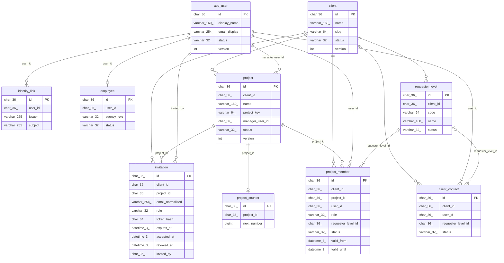
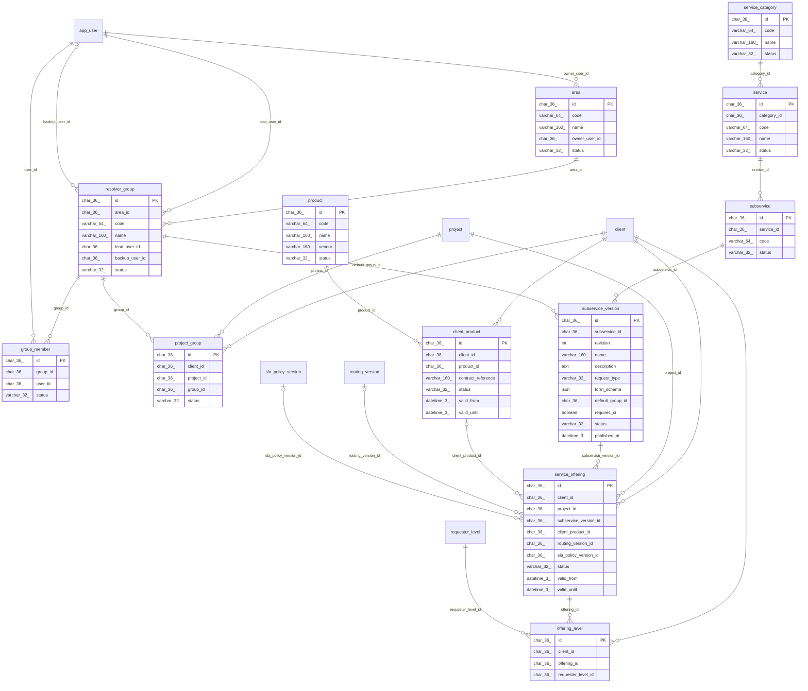
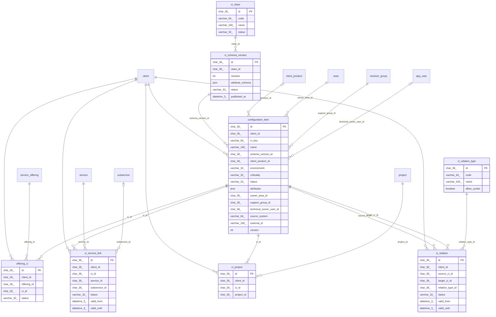
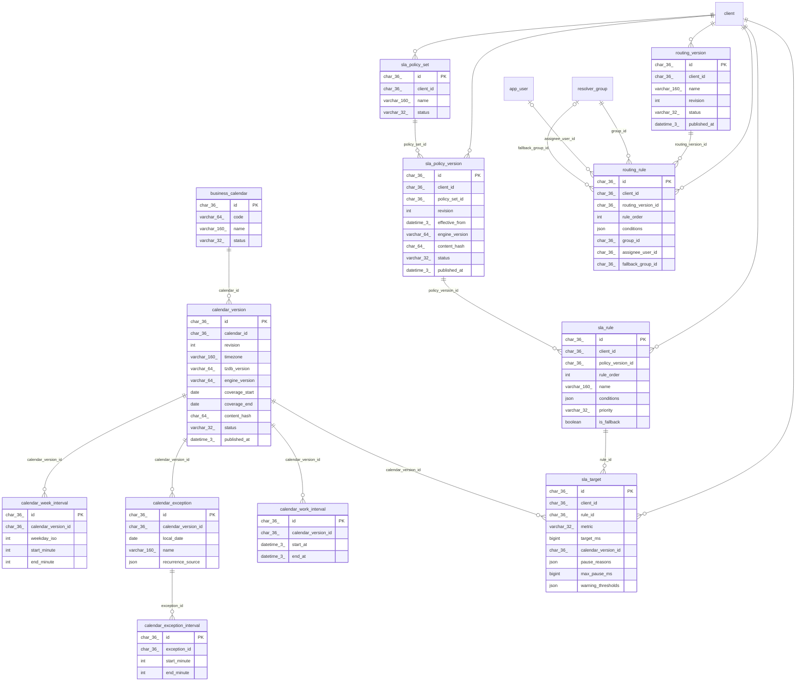
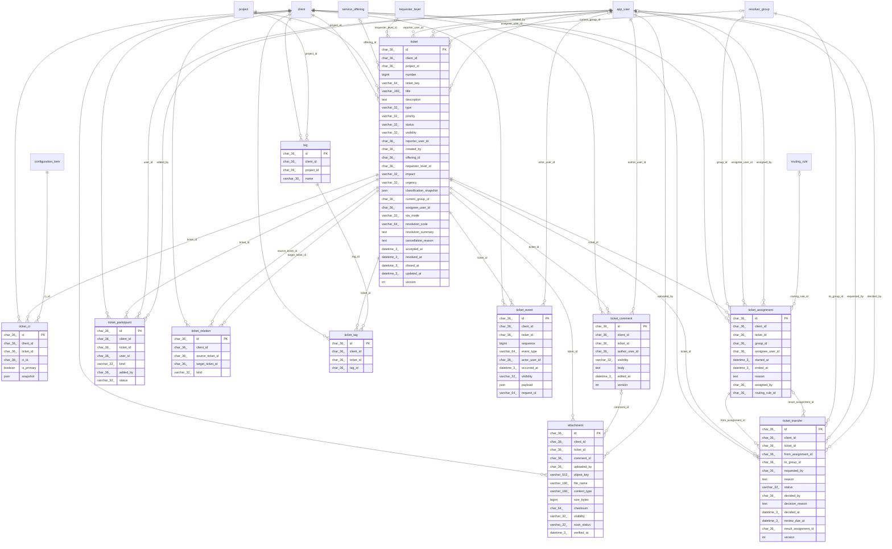
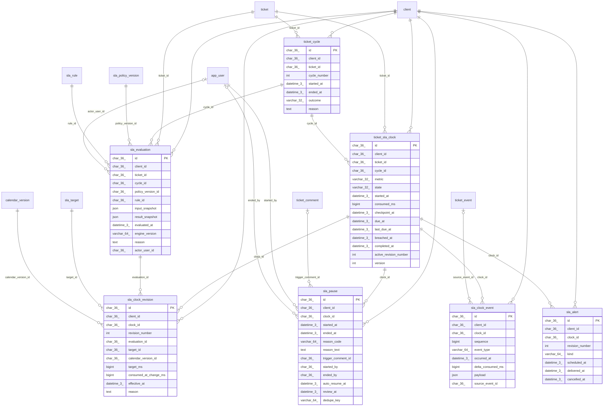
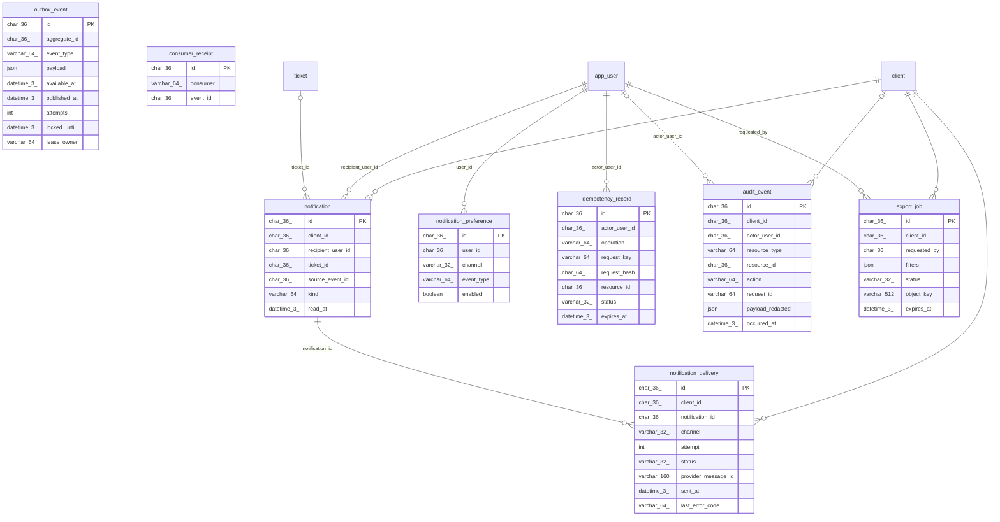
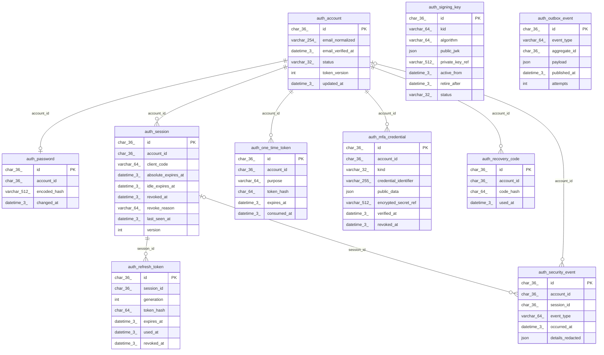

# Diagramas entidad-relación por módulo

Los enlaces entre servicios son lógicos, no claves foráneas. Una línea o{ representa múltiples filas y o| cero o una; FK opcionales se indican con |o. Las tablas externas al módulo aparecen como contexto.

## Identidad local y permisos

## Organización y catálogo

## CMDB

## Calendarios y políticas

## Tickets y colaboración

## SLA en ejecución

## Operación

## Servicio de autenticación opcional

